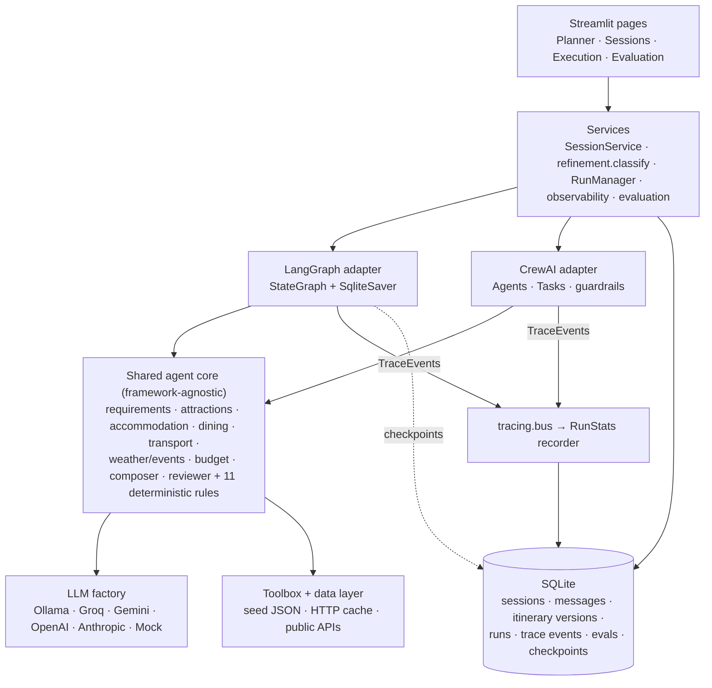
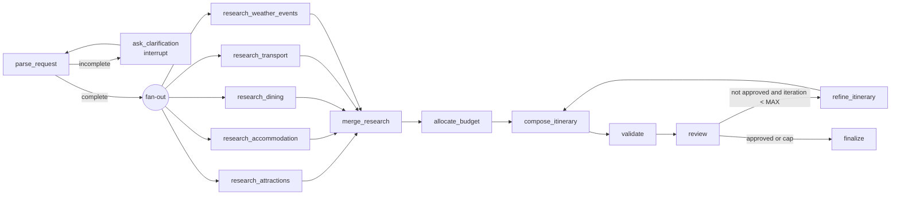

# Dubai AI Travel Planner — LangGraph vs CrewAI

An academic **multi-agent system** that turns a natural-language request ("4 days in
March, AED 3,000, street food and history") into a **budget-aware, feasible,
explainable, day-by-day Dubai itinerary**. The same framework-agnostic agent core is
orchestrated two ways, so the paradigms can be compared on identical inputs:

- **LangGraph**: explicit state graph, parallel research fan-out, bounded review loop,
  SQLite checkpoints, human-in-the-loop clarification;
- **CrewAI**: role-based crew (sequential with async research, or hierarchical with a
  manager that delegates), guardrail-driven review.

Status: phases 0–7 implemented (see [`implementationPlan.md`](implementationPlan.md) for
every acceptance criterion and its evidence). Design: [`architecture.md`](architecture.md);
goals and success criteria: [`problemStatement.md`](problemStatement.md); background:
[`research.md`](research.md); evaluation: [`docs/evaluationReport.md`](docs/evaluationReport.md).

## Contents
1. [Problem](#1-problem) · 2. [Technology stack](#2-technology-stack) ·
3. [Setup and local run](#3-setup-and-local-run) · 4. [Configuration](#4-configuration) ·
5. [Architecture](#5-architecture) · 6. [LangGraph parallelism](#6-langgraph-orchestration-and-parallelism) ·
7. [CrewAI collaboration](#7-crewai-collaboration-and-delegation) · 8. [State schemas](#8-shared-state-and-agent-schemas) ·
9. [Persistence](#9-persistence-and-checkpointing) · 10. [Prices and provenance](#10-prices-sources-and-provenance) ·
11. [Refinement routing](#11-refinement-classification-and-routing) · 12. [Review loop](#12-review-loop-termination) ·
13. [Caps](#13-retry-iteration-and-execution-caps) · 14. [Evaluation](#14-evaluation-methodology-and-results) ·
15. [Session transcript](#15-session-transcript) · 16. [Limitations](#16-known-limitations) ·
17. [Deployment](#17-deployment-streamlit-community-cloud) · 18. [Repository layout](#18-repository-layout)

## 1. Problem

Planning a Dubai trip couples many decisions: attractions, neighbourhoods, hotels,
dining, transport, summer heat above 40 °C, Ramadan and events, and a fixed budget.
Single-prompt chatbots produce plausible plans that overspend, schedule outdoor
sightseeing at noon in July, ignore travel time, invent venues and prices, and lose
context when asked to "swap day 2". This project splits the work into specialised
agents, keeps every number deterministic, grounds every venue in curated data, and
checks every plan against explicit rules before it is shown. Success criteria S1–S8 are
in [`problemStatement.md` §7](problemStatement.md); their status is in
[§14](#14-evaluation-methodology-and-results).

## 2. Technology stack

| Concern | Choice (pinned in `pyproject.toml`) |
|---|---|
| Language | Python 3.12 (`requires-python >=3.11,<3.13`) |
| Orchestration | LangGraph 1.2.22 + `langgraph-checkpoint-sqlite` 3.1.3; CrewAI 1.15.41 |
| LLM access | LangChain Core 1.8.1 adapters; providers: Ollama, Groq, Gemini, OpenAI, Anthropic, and an offline **mock** |
| Contracts | Pydantic v2 everywhere (`src/dubai_planner/models`) |
| UI | Streamlit 1.67, Plotly, pydeck, Graphviz (browser-rendered) |
| Persistence | SQLite (sessions, messages, versions, runs, traces, evals) + LangGraph checkpoints; JSON seed data and HTTP cache |
| Public data (keyless) | Open-Meteo, OSM Overpass/Nominatim, Wikivoyage, Frankfurter, `hijridate` |
| Quality | pytest (+respx, AppTest), ruff, mypy `--strict`, matplotlib for report charts |

## 3. Setup and local run

Requirements: Python **3.12**, Git. Windows 11 is the primary target; macOS/Linux work
with the equivalent commands. On Windows, turn off the Microsoft Store `python` aliases
(*Settings → Apps → Advanced app settings → App execution aliases*). Ollama is optional.

```powershell
git clone <your-repo-url> dubai-ai-travel-planner; cd dubai-ai-travel-planner
python --version                   # must print 3.12.x (or use: py -3.12 -m venv .venv)
python -m venv .venv; .\.venv\Scripts\Activate.ps1
python -m pip install -U pip
pip install -e ".[dev,langgraph,crewai,ui]"
Copy-Item .env.example .env        # then set LLM_PROVIDER (see §4)

pytest -m "not llm"                # offline suite: no network, no keys (mock LLM)
ruff check . ; mypy src            # lint + strict typing
streamlit run app/streamlit_app.py # the app (LLM_PROVIDER=mock works offline)
```

macOS/Linux: `python3.12 -m venv .venv && source .venv/bin/activate`, then the same
`pip`/`pytest`/`streamlit` commands (`cp .env.example .env`). Windows shortcut:
`.\scripts\tasks.ps1 setup | test | lint | run | eval` (run
`Set-ExecutionPolicy -Scope CurrentUser RemoteSigned` once if scripts are blocked).

Other commands:

```powershell
python scripts/run_eval.py --provider mock            # benchmark → eval/reports/<timestamp>/
python scripts/session_transcript.py                  # transcript → docs/transcripts/
python scripts/init_db.py                             # create/migrate data/app.db
python scripts/export_langgraph.py                    # graph → docs/generated/langgraph.mmd
pytest -m llm                                         # real-provider tests (spend quota)
```

**App pages:** *Planner* (chat, live progress, itinerary with day tabs, map, cost table,
budget gauge, review outcome, JSON/Markdown export), *Sessions* (rename, delete, version
history and diff), *Execution* (graph with live step status, Gantt timeline, inspector,
state & review, run comparison), *Evaluation* (metric table, distributions per mode,
per-scenario drill-down, fault injection, judge).

## 4. Configuration

Everything is read by `config.Settings` (pydantic-settings) from environment variables
or a git-ignored `.env` (documented in [`.env.example`](.env.example)). **Never commit
keys**: secrets are `SecretStr`, redacted from logs, traces, run records and exports. On
Streamlit Community Cloud the same names go into *Secrets* (§17).

| Variable | Purpose (default) |
|---|---|
| `LLM_PROVIDER` | `ollama` (default) \| `groq` \| `gemini` \| `openai` \| `anthropic` \| `mock` |
| `LLM_MODEL`, `LLM_MODEL__<AGENT>` | model (empty = provider default, Groq: `openai/gpt-oss-20b`); per-agent override, e.g. `LLM_MODEL__JUDGE` |
| `GROQ_API_KEY`, `GEMINI_API_KEY`, `OPENAI_API_KEY`, `ANTHROPIC_API_KEY` | only for the provider you use; a missing key gives an error naming the variable |
| `LLM_TEMPERATURE`, `LLM_BASE_URL`, `LLM_TIMEOUT_S`, `LLM_MAX_RETRIES`, `LLM_REPAIR_ATTEMPTS`, `LLM_MAX_TOKENS`, `LLM_REASONING_EFFORT` | sampling, endpoint, per-call timeout (120 s), SDK retries (2), schema repairs (1), output cap (Groq 4096), reasoning effort (gpt-oss: low) |
| `DB_PATH`, `CHECKPOINT_DB_PATH`, `CACHE_DIR`, `CACHE_TTL_HOURS`, `SEED_DIR` | storage (`data/app.db`, `data/checkpoints.db`, `data/cache`, 24 h, `data/seed`) |
| `HTTP_USER_AGENT`, `HTTP_TIMEOUT_S`, `HTTP_OFFLINE` | public APIs: a **real contact** is required by OSM/Wikimedia; `true` = cache + seed only |
| `MAX_REVIEW_ITERATIONS`, `BUDGET_TOLERANCE` | review-loop cap (2), budget tolerance (0.05) |
| `SESSION_SCOPE` | `visitor` (default; required for any shared deployment): each browser tab sees only its own sessions and runs \| `shared`: single-user local mode, every session visible and reopened from `?session=<id>` after a refresh |
| `CREWAI_PROCESS`, `CREWAI_AGENT_MAX_ITER` | `sequential` \| `hierarchical`; LLM calls per CrewAI agent per attempt (4) |
| `CREWAI_DISABLE_TELEMETRY`, `CREWAI_TRACING_ENABLED`, `OTEL_SDK_DISABLED` | keep `true`/`false`/`true`: no telemetry, no 20 s trace prompt |
| `LOG_LEVEL`, `DUBAI_PLANNER_ROOT` | logging; optional repo root override (deployments) |

Hosted providers need their LangChain package (`pip install -e ".[providers]"` or just
`langchain-groq`). The mock provider needs nothing and is what the tests use.

## 5. Architecture



Hard rules (enforced by tests): no hardcoded secrets; free/offline first; one shared core
with thin framework adapters; money, costs, travel times and rule checks are Python
(`Decimal`), never LLM output; agents pick venues **by id** from tool results (no invented
venues); Pydantic at every boundary with one repair retry, then fail loudly.

## 6. LangGraph orchestration and parallelism



The five research nodes leave `parse_request` on static edges, so LangGraph runs them in
**one super-step concurrently**; each writes a partial dict to `research`, merged by the
custom reducer `merge_research` (no `InvalidUpdateError`). Measured, not assumed: with
each research agent stubbed to sleep 1 s, the stage takes < 1.8 s instead of ≈ 5 s and
every pair of spans overlaps (AC3.2); in the benchmark the research window is ≈ 0.29 ×
the sum of the research step durations (S4 requires < 0.6). The graph is compiled from
`orchestration/langgraph/graph.py` and exported to `docs/generated/langgraph.mmd`.

## 7. CrewAI collaboration and delegation

Ten roles with YAML role/goal/backstory (`orchestration/crewai/config/agents.yaml`) and
nine tasks (`tasks.yaml`). Each specialist owns one **stage tool** that runs the same
shared agent as the LangGraph node, puts the typed result on a per-run board and returns a
short brief (`result_as_answer=True`), so grounded data is never retyped by an LLM.

- **Sequential** (default): research tasks have `async_execution=True` and overlap; the
  Budget Controller's task lists them in `context`; the Itinerary Architect's task has a
  guardrail that runs the deterministic rules and rejects errors with targeted feedback
  (CrewAI retries the task); the Quality Reviewer's guardrail records the attempt. A
  reviewer rejection without rule errors starts a compose → review **revision crew**.
- **Hierarchical**: a Trip Manager (`manager_agent`) runs every task and **delegates** it
  with CrewAI's delegation tool to the role named on the task's "Responsible specialist"
  line (one delegation event per task in the trace). Research is not async here (one
  manager executor is not thread-safe), and tasks declare no `output_pydantic`, because
  CrewAI would otherwise add a manager call per task to re-type specialist output.

## 8. Shared state and agent schemas

**LangGraph shared state** (`orchestration/langgraph/state.py`, `PlannerState`, values
are Pydantic models from `dubai_planner.models`, checkpointed with an allowlisted
serializer):

| Group | Keys (reducer) |
|---|---|
| Identity / input | `session_id`, `run_id`, `today`, `user_message`, `messages` (append) |
| Requirements | `draft: TripRequestDraft`, `fixed_request`, `request: TripRequest`, `missing`, `clarification_question`, `clarifications`, `assumptions` |
| Research and plan | `research: ResearchBundle` (`merge_research`), `budget_plan: BudgetPlan`, `itinerary: Itinerary`, `validation: list[RuleViolation]`, `review: ReviewReport` |
| Review loop | `iteration`, `feedback`, `locked_days`, `day_constraints`, `best: Attempt`, `attempts: list[AttemptSummary]`, `status: PlanStatus`, `saved_version` |

**CrewAI shared state** is the per-run `CrewRunBoard` (typed stage outputs, request,
attempts, iteration) plus task `context`; the board never leaves the process. Both modes
return the same `PlanResult` / `PlannerUpdate` contract (`models/planning.py`).

**Agent-specific schemas** (each `agents/<name>.py` exposes `run(input, llm, tools)`):

| Agent | Input model | Output model | LLM role |
|---|---|---|---|
| Requirements | `RequirementsInput` (message, history, previous draft, today) | `RequirementsResult` (draft, `TripRequest`, missing, question, assumptions) | extraction into `RequirementsExtraction`; dates/currency resolved in Python |
| Attractions / Accommodation / Dining | `AttractionsInput` / `AccommodationInput` / `DiningInput` | `SelectionResult[AttractionOption \| HotelOption \| DiningOption]` | ranks candidate **ids** from the search tool; unknown ids rejected |
| Transport | `TransportInput` | `TransportPlan` | none (deterministic fares and haversine estimates) |
| Weather & events | `WeatherEventsInput` | `WeatherEventsResult` (`WeatherContext`, `EventInfo`s) | none |
| Budget | `BudgetInput` | `BudgetPlan` (allocations, feasibility, rationale) | rationale text only; maths in Python |
| Composer | `ComposerInput` (request, research, budget, feedback, locked days, day constraints) | `Itinerary` | drafts slots by id (`DraftItinerary`); Python grounds, prices and validates |
| Reviewer | `ReviewerInput` (itinerary, request, rule violations) | `ReviewReport` | adds quality issues; cannot approve over a rule error |

## 9. Persistence and checkpointing

SQLite `data/app.db` (`storage/schema.sql` + `schema_v2.sql` + `schema_v3.sql`, migrated
with `PRAGMA user_version`) and `data/checkpoints.db` (LangGraph `SqliteSaver`, `thread_id =
session_id`, written with `durability="sync"` so a killed process resumes from the last
finished node).

| Persisted | Where |
|---|---|
| Sessions, full chat history (with routing metadata) | `sessions`, `messages` |
| Every itinerary version with its request, parent link, approval flag and run | `itineraries` (v(n+1).parent = v(n)) |
| Run records: status, duration, LLM calls, tokens in/out, LLM latency, review iterations, fairness context (provider, model, data fingerprint) | `runs` |
| Trace events (node/task spans, LLM calls with prompt previews, guardrail verdicts, delegations, validated step outputs), secrets redacted | `trace_events` |
| Evaluation runs and per-cell metrics | `eval_runs`, `eval_results` (`data/eval.db` for the benchmark) |
| LangGraph checkpoints (resume, clarification `interrupt`) | `data/checkpoints.db` |
| Public-API responses (TTL) | `data/cache/*.json` |

**Deliberately not persisted:** API keys and any secret value; full LLM prompts and
responses (only previews of our instructions and the traveller's words); Streamlit
widget state (only `session_id` and UI flags live in `st.session_state`; truth is in
SQLite); in-memory run handles (a run interrupted by an app restart is shown as
stopped); CrewAI's own replay log and telemetry (disabled); CrewAI mid-run state (no
checkpointer, so `resume()` restarts the unfinished request).

## 10. Prices, sources and provenance

- **No live prices exist for free**, so hotel, restaurant and ticket prices are curated
  **price bands** in `data/seed/*.json` (61 attractions, 43 hotels in 12 areas, 65
  restaurants with dietary flags). Every record carries `provenance` (`kind`, `source`,
  `source_url`, `as_of`, licence, note). All seed prices are `estimated` (a test enforces
  it); the UI labels every amount "≈ AED … (estimate)" with source and as-of date on hover.
- Live sources (keyless, cached, seed fallback): Open-Meteo weather and climate, OSM
  Overpass/Nominatim, Wikivoyage, Frankfurter FX (AED via the fixed USD peg 3.6725),
  `hijridate` for Ramadan/Eid (approximate). Nager.Date has no UAE data, so holidays come
  from seed + `hijridate`.
- Limitations: venues and prices were not re-verified live and may have changed;
  coordinates are approximate until `scripts/refresh_seed.py --write`; no venue is
  recorded as wheelchair-*inaccessible* (18 attractions and all hotels/restaurants are
  "unknown"), so accessibility checks can only warn about unknown access.
- Attribution: map/POI data © OpenStreetMap contributors (ODbL); travel text from
  Wikivoyage (CC BY-SA).

## 11. Refinement classification and routing

Every chat message goes through `services/refinement.classify` (pure Python, from SQLite
only, so it works the same in both modes and across modes):

| Kind | Trigger | What is sent to the planner |
|---|---|---|
| `clarification_answer` | the planner is waiting on a question | the answer resumes the run (LangGraph `Command(resume=…)`; CrewAI continues the same `run_id`) |
| `new_request` | the session has no itinerary yet | the message |
| `request_delta` | budget, dates, length or travellers change | full re-plan; a **relative budget** change ("by 20%", "add AED 500") is resolved in Python and stated: "…: the new total budget is AED 4800." |
| `local_edit` | the message names days ("day 2", "last day") | the request is reused **without an LLM call**; other days are locked and copied verbatim; deterministic `DayConstraint`s (e.g. `indoor_only`) + the user's words go to the composer |
| `general_change` | anything else ("we are vegetarian now") | re-plan with the saved request as the base; the requirements agent merges the change |

## 12. Review loop termination

An attempt is **approved** only if the reviewer approves **and** no error-severity rule
fails (checked in Python, independently of the reviewer). The loop ends when:

1. the attempt is approved → `finalize` (status `approved`);
2. `iteration ≥ MAX_REVIEW_ITERATIONS` (default 2, so at most 3 compositions) → the **best
   attempt** (approved, then fewest errors, then highest score) is returned and saved
   **unapproved** with its issues (`needs_revision`), never hidden;
3. clarification is needed → the run pauses (`needs_clarification`); at most 3 rounds;
4. a non-transient error → `failed` with a short, secret-free message (resumable).

Refinement is targeted: if every blocking issue names a day, other days are locked. In
CrewAI the compose guardrail rejections and the outer revision crew share the same
`MAX_REVIEW_ITERATIONS` budget; at the cap the guardrail accepts the attempt unapproved,
so the loop always ends. LangGraph additionally sets a `recursion_limit` derived from both
caps.

## 13. Retry, iteration and execution caps

| Cap | Value | Where |
|---|---|---|
| Review refinements | `MAX_REVIEW_ITERATIONS` = 2 (≤ 3 compositions) | both modes |
| Clarification rounds | 3 | both modes |
| Schema repair after invalid LLM output | `LLM_REPAIR_ATTEMPTS` = 1, then `StructuredOutputError` | `llm/structured.py` |
| Provider SDK retries / per-call timeout | `LLM_MAX_RETRIES` = 2 / `LLM_TIMEOUT_S` = 120 s | factory |
| Transient errors (429, 5xx, timeout) | 4 attempts, ≈ 8/16/32 s backoff + jitter | LangGraph `RetryPolicy`; CrewAI `call_with_retry` |
| CrewAI agent loop | `CREWAI_AGENT_MAX_ITER` = 4 LLM calls per task attempt; `guardrail_max_retries` = cap + 2 | crew factory |
| Graph recursion | derived from review and clarification caps | LangGraph |
| User message | ≤ 4 000 characters; wrapped in `<user_request>` and treated as data | `orchestration/common.py`, `agents/base.py` |
| Concurrent runs | one active run per session (`RunInProgress`) | `services/runs.py` |
| Public APIs | timeout 20 s, bounded retries, Nominatim ≤ 1 req/s, cache TTL 24 h | `data/http.py` |
| Evaluation | per-turn timeout 1 800 s; `--max-tokens` budget; stop on a daily-quota error; `--resume` | `evaluation/runner.py` |

## 14. Evaluation methodology and results

`scripts/run_eval.py` runs **13 scenarios** (`eval/scenarios/*.json`: budget, family,
luxury, summer heat, Ramadan, vegetarian + wheelchair in July, Abu Dhabi day trip,
infeasible budget, vague request, three-turn refinement, vegan + relaxed, USD budget,
group of four) × modes × repetitions, through the **same path as the app** (refinement
classification → planner → SQLite), with identical text, seed data (fingerprinted) and
rules. Each cell is scored by `evaluation/metrics.py` from what was recorded:
schema validity (S1), budget compliance against the **user's** budget or an explicit
infeasibility explanation (S2), hard constraints from the user's words (days,
travellers, dietary, accessibility, pace, heat safety, family, latest end, day trip,
indoor days; S3), an independent re-run of the 11 rules, interest match, grounding,
travel per day, latency, LLM calls, tokens, review iterations, guardrail rejections and
research overlap (S4). An optional judge scores a 1–5 rubric and runs **position-swapped**
pairwise comparisons (a win counts only if both orders agree). A fault-injection suite
(`evaluation/faults.py`) corrupts the first composition with 8 seeded defects and checks
the review loop detects and repairs them (S5). Reports: CSV, JSONL, PNG charts and
Markdown with mean ± sample std.

**Three evaluation results** (full analysis: [`docs/evaluationReport.md`](docs/evaluationReport.md)):

| # | Result | Provider | Outcome |
|---|---|---|---|
| E1 | 13 scenarios × 3 modes × 3 repetitions (117 cells) — [`eval/results/mock-benchmark/report.md`](eval/results/mock-benchmark/report.md) | **mock** (offline) | identical plan quality in every mode (same core): valid 100 %, budget-compliant 92 %, hard constraints 98 %; orchestration cost differs: LLM calls 8.8 (LangGraph) / 19.3 (CrewAI seq.) / 41.0 (CrewAI hier.); research overlap 0.30 / 0.23 / 1.03 (window ÷ summed durations) |
| E2 | Fault injection: 8 seeded defects × 3 modes — `eval/results/mock-benchmark/faults.csv` | **mock** | 100 % detected, 100 % of error defects repaired, every mode |
| E3 | 3 scenarios × LangGraph + CrewAI sequential, judge gpt-oss-120b — [`eval/results/groq-subset/report.md`](eval/results/groq-subset/report.md) | **Groq `openai/gpt-oss-20b`** (free tier) | stopped by the daily quota after 4 cells: LangGraph 2/2 approved within budget, all constraints met, judge 4.75 and 4.00, 119–141 s, 7–8 LLM calls, ≈ 21.5k tokens; CrewAI sequential 0/2 (HTTP 413 per-request limit; then the daily quota) |

> E1 and E2 use the deterministic mock LLM: they show orchestration behaviour on
> identical inputs, not real-model quality (mock tokens are estimates, mock latencies
> are not model latencies, the mock judge is a constant placeholder). Only E3 used a
> real model, and it is incomplete (AC7.2 not met).

**Success criteria** (details and evidence in the evaluation report): S1 valid output —
met with the mock, not on the real free tier (CrewAI failed); S2 budget — met (92 %);
S3 constraints — met (98 %); S4 parallelism — met under controlled conditions (0.30;
stubbed test < 1.8 s for 5 × 1 s), not under free-tier throttling (0.79–0.94); S5 review
loop — met (100 %); S6 persistence — met; S7 visualisation — met; S8 comparative report —
met with the mock, real-model comparison incomplete.

**Hypotheses** (`research.md §1.3`): LangGraph lower latency — held; CrewAI more LLM
calls/tokens — held; LangGraph validity ≥ CrewAI with small models — held, but because
CrewAI's larger requests hit the provider's per-request limit, not because of bad JSON;
CrewAI narrative quality — not tested (no CrewAI real-model plan); loops cost less
developer effort in LangGraph — held (qualitative; 899 vs 1 595 adapter lines).

## 15. Session transcript

`python scripts/session_transcript.py --mode langgraph` (and `--mode crewai_sequential`)
plays a conversation through the app's own services, closes everything, then reopens
the database **in a new Python process** and compares what it reads with what was there
before closing. Committed outputs: [`docs/transcripts/session_langgraph.md`](docs/transcripts/session_langgraph.md)
and [`docs/transcripts/session_crewai_sequential.md`](docs/transcripts/session_crewai_sequential.md)
(+ `.json`). Mock provider, so the routing and persistence are exactly the app's, while
the itineraries come from the deterministic baseline scheduler.

| Turn | User input | Routing | Result (LangGraph run) |
|---|---|---|---|
| 1 | “2 adults, 10-12 Feb 2027, AED 6000, history and food” | `new_request` | v1 approved, AED 4 258.65 of 6 000 |
| 2 | “reduce the budget by 20%” | `request_delta`: Python resolves AED 6000 → 4800 and states it | v2 (parent v1) approved, AED 3 250.59; every day re-planned with cheaper restaurants |
| 3 | “Replace day 2 with indoor activities” | `local_edit`: days 1 and 3 locked, day 2 `indoor_only`, request reused without an LLM call | v3 (parent v2); diff: only day 2 changed (souks → museum and indoor venues) |
| 4 | “We are vegetarian now, please only choose vegetarian-friendly restaurants” | `general_change`: requirements agent merges `dietary=[vegetarian]` | v4 (parent v3); every restaurant vegetarian-friendly |
| — | app closed; database reopened **in a new process** | — | chat history (8 messages), versions v1–v4 with parent links, latest itinerary, run records and the LangGraph checkpoint thread: all identical (6/6 checks PASS; CrewAI 5/5, it has no checkpointer) |

The files also record, per turn, the message actually sent to the planner, the steps that
ran, LLM calls, tokens, review iterations, the cost delta per category and the
added/removed slots per day. One finding is visible in turn 4: a *general* change
re-plans every day, so the indoor-only day 2 from turn 3 is not carried forward (see §16).

## 16. Known limitations

- **Real-model evidence is partial.** On Groq's free tier (8 000 tokens/min, 200 000
  tokens/day per model) only 4 real cells ran before the daily quota stopped the
  evaluation: LangGraph approved both of its scenarios; **CrewAI sequential failed both**,
  one with HTTP 413 (a single request of 8 561 tokens exceeds the per-minute cap, because
  the crew's prompts carry task context and inlined output schemas) and one on the daily
  quota. AC7.2 (≥ 10 scenarios × 2 modes on a real model) is **not met**; the runner can
  finish it over several days with `--resume` or on a local/paid provider.
- **Mock-provider results measure orchestration, not quality.** The mock's itineraries
  come from a deterministic scheduler; its token counts are prompt-length estimates; its
  judge is a constant placeholder.
- **Parallelism needs provider throughput.** Research nodes do run concurrently, but on
  the free tier the parallel LLM calls hit the per-minute limit and are retried one after
  another, so the measured research window was 0.79–0.94 × the summed durations (S4 asks
  for < 0.6); with the mock it is ≈ 0.29.
- **Not modelled:** "no late nights" (no latest-end field; the mock schedules dinner until
  22:00), "include a day trip to Abu Dhabi" (not parsed into a must-include by the mock).
- **A general change re-plans every day**, so an earlier day-specific edit (e.g. indoor day
  2) is not preserved; only relative *budget* changes are resolved in Python.
- **Accessibility data is thin:** no venue is recorded as inaccessible, so the rule can
  only flag "access unknown".
- **Prices are estimates** from curated bands, not live; venues may have changed.
- **CrewAI** has no checkpointer (resume restarts the request) and hierarchical mode runs
  research one task at a time.
- **No accounts:** with `SESSION_SCOPE=visitor` sessions are private to the browser tab
  that created them (see §17), so a refresh or a new tab starts empty. All visitors
  share one provider key and its quota, so a public demo should use the mock provider.
- **Hosted SQLite is ephemeral** on Streamlit Community Cloud (see §17).

## 17. Deployment (Streamlit Community Cloud)

**Readiness (verified locally, 2026-11-17):** `requirements.txt` resolves for Linux
x86-64 / CPython 3.12 with binary wheels only (164 packages; reference lock in
`docs/deployment/requirements-linux-py312.lock.txt`); a fresh virtual environment built
from `requirements.txt` alone (non-editable install, no `.env`, configuration only
through environment variables as Cloud secrets provide it) starts the app headless, the
health endpoint answers `ok`, and the home and planner pages plan a trip with the mock
provider. Seed data and prompts are found from the deployed checkout
(`config._project_root()`), and prompts/YAML/SQL ship as package data.
**Not verified:** a real Streamlit Community Cloud deployment (no public URL exists yet)
and its memory headroom for CrewAI + chromadb imports.

**1. Publish to GitHub** (from the project folder):

```powershell
git checkout main; git merge --ff-only phase-7
git ls-files | Select-String -Pattern '\.env$|secrets\.toml$|\.db$'   # must print nothing
# create an empty repository on github.com (no README/licence), then:
git remote add origin https://github.com/<your-user>/dubai-ai-travel-planner.git
git push -u origin main
git push origin phase-2 phase-3 phase-4 phase-5 phase-6 phase-7   # optional history
```

**2. Deploy on Streamlit Community Cloud** (<https://share.streamlit.io>):

1. Sign in with GitHub and authorise access to the repository.
2. *Create app* → *Deploy a public app from GitHub* → repository
   `<your-user>/dubai-ai-travel-planner`, branch `main`, main file path
   `app/streamlit_app.py`.
3. *Advanced settings* → **Python version 3.12** → *Secrets*: paste the lines from
   [`.streamlit/secrets.toml.example`](.streamlit/secrets.toml.example). For an offline
   demo: `LLM_PROVIDER = "mock"`, `HTTP_OFFLINE = "true"` and
   `SESSION_SCOPE = "visitor"`. For a real model:
   `LLM_PROVIDER = "groq"` and `GROQ_API_KEY = "<your key>"` (never put the key in the
   repository).
4. *Deploy*. The first build installs about 165 packages and takes several minutes.
5. Check the app: the home page loads; the *Planner* plans
   “2 adults, 10-12 Feb 2027, AED 6000, history and food”; *Evaluation* lists the
   published results. Then copy the app URL (`https://<name>.streamlit.app`).

**Persistence on Community Cloud is not durable.** The container's filesystem is
ephemeral: `data/app.db` and `data/checkpoints.db` (sessions, versions, traces) survive
reruns and browser refreshes while the container lives, but are lost on reboot,
redeploy or sleep after inactivity. Durable hosted persistence would need an external
database, which is not implemented. Published evaluation results live in the repository
(`eval/results/`), so the *Evaluation* page always works.

**Visitor isolation (`SESSION_SCOPE = "visitor"`, the default).** The app has no
accounts. The first page a browser tab runs creates a random 256-bit *visitor token*
on the server (`secrets.token_urlsafe(32)`) and keeps it in that tab's server-side
`st.session_state`. The token is never sent to the browser, put in a URL, shown, logged
or traced. Every session stores only the token's SHA-256 (`sessions.owner`, schema v3).
Ownership is enforced in the services, not by hiding widgets:
`SessionService.scoped(owner)` and `RunManager.scoped(...)` check every read and write
(history, versions, version comparison, exports, rename, delete, runs, traces, starting
a run); rename and delete repeat the owner condition in SQL. Another visitor's session or
run behaves exactly like a missing one. `?session=` and `?run=` links to it are refused,
and in this scope session ids are not written to the URL.

What this does **not** give you:

- **Persistence across refreshes.** Streamlit cannot set a cookie from Python, so the
  identity lasts as long as the tab's Streamlit session. A refresh, a new tab or an app
  restart is a new visitor, and the earlier sessions can no longer be opened (they stay
  in SQLite until the container is recycled). For persistent identities, configure
  Streamlit's OIDC login (`st.login`, an `[auth]` section in Secrets and `Authlib`).
  When a user is logged in, the owner is derived from the identity provider's
  `iss`/`sub` instead (`Owner.from_identity`). That path is implemented and unit-tested
  but has not been tried against a real identity provider.
- **Protection against the server operator** or anyone with access to the SQLite file.
- **Rate limiting.** With a real provider key, every visitor spends its quota.

Legacy sessions (created before schema v3) have no owner. They remain visible in
`SESSION_SCOPE = "shared"` (local single-user use) and are never shown to a visitor.
Use `SESSION_SCOPE=shared` in your local `.env` if you want the old behaviour (one
user, refresh reopens the session).

**Recommended public demo secrets:** `LLM_PROVIDER = "mock"`, `HTTP_OFFLINE = "true"`,
`SESSION_SCOPE = "visitor"`, no API key. The app then shows a *deterministic mock
model, not real AI inference* banner and a notice that its SQLite data is temporary.

## 18. Repository layout

```
app/                 Streamlit entry (streamlit_app.py) and pages 1_Planner … 4_Evaluation
src/dubai_planner/   config, models, llm, data, tools, agents (+prompts), validation,
                     orchestration/{langgraph,crewai}, services, storage, tracing, evaluation
data/seed/           curated JSON (committed); data/cache, *.db are git-ignored
eval/scenarios/      13 benchmark scenarios; eval/results/ published reports
docs/                evaluationReport.md, transcripts/, deployment/, generated/
scripts/             run_eval, session_transcript, init_db, refresh_seed, export_langgraph, tasks.ps1
tests/               unit/, integration/, ui/ (offline with the mock provider)
requirements.txt     deployment dependencies (Streamlit Community Cloud)
.streamlit/          config.toml (no secrets) and secrets.toml.example
```

Map / POI data © OpenStreetMap contributors (ODbL); travel text from Wikivoyage (CC BY-SA).
Prices shown by the app are **estimates** from curated public data.
