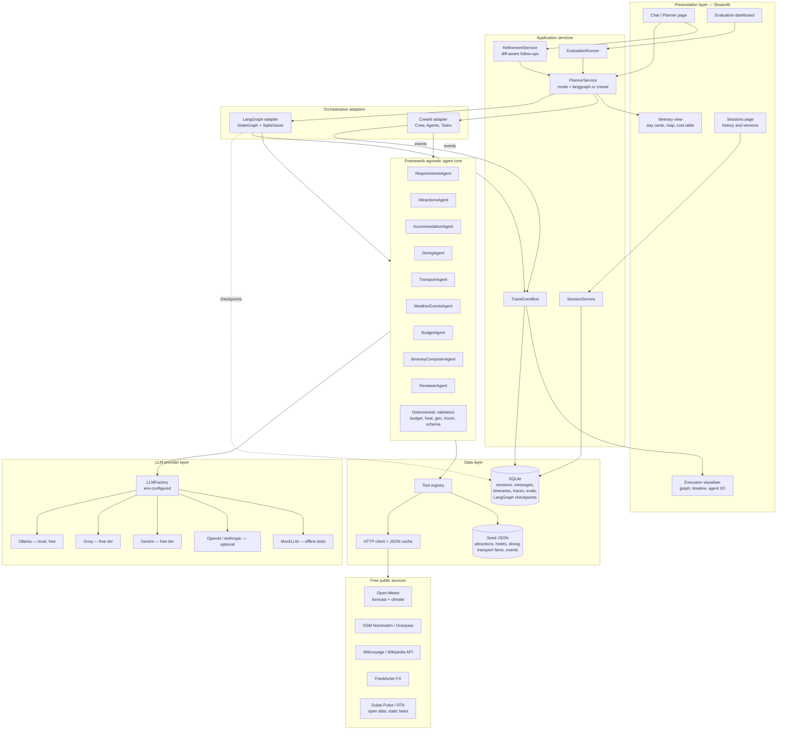
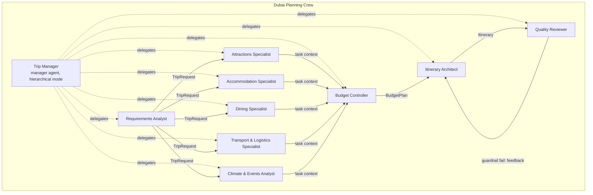
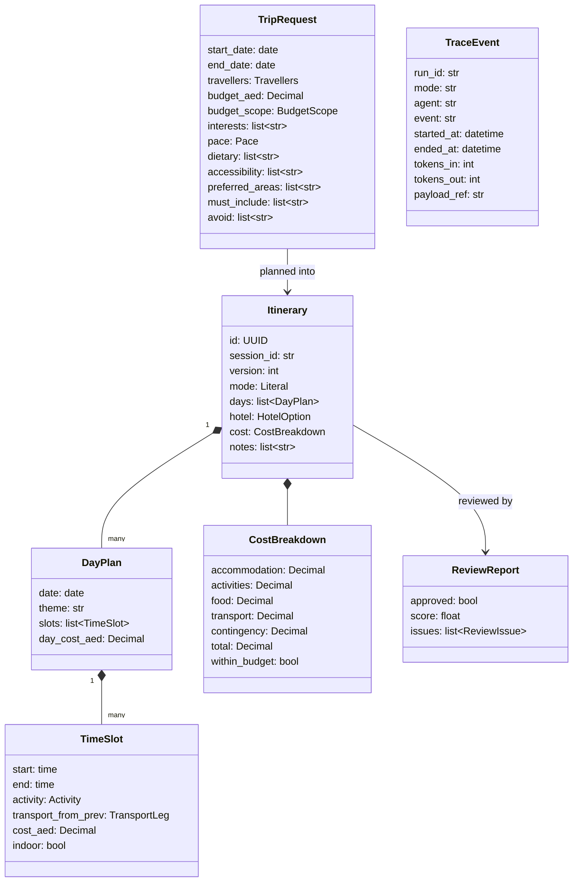
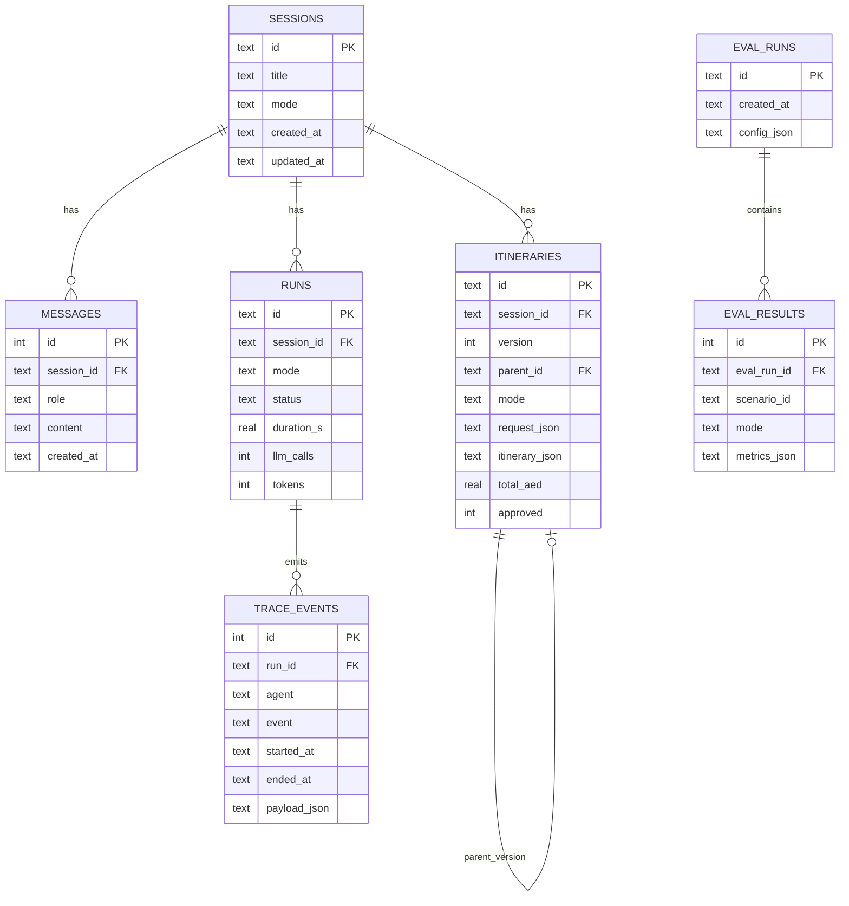
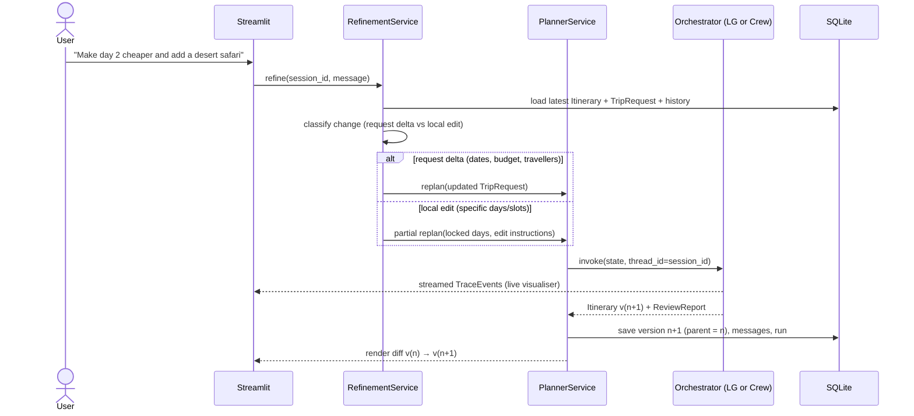

# Architecture — Dubai AI Travel Planner

## 1. Design principles

1. **One domain, two orchestrators.** Agents' *capabilities* (prompts, tools, Pydantic I/O contracts) live in a framework-agnostic core. LangGraph and CrewAI are thin orchestration adapters over the same core, so the evaluation compares orchestration and not different business logic.
2. **Structured everything.** Every agent output is a Pydantic model. LLM text is parsed and validated, and retried on validation failure.
3. **Deterministic where possible.** Budget arithmetic, distance/travel-time estimates, heat rules and schema checks are plain Python, not LLM calls. LLMs pick, rank, write and explain.
4. **Free and offline first.** Keyless public APIs with on-disk JSON caching, curated seed data as fallback, and a mock LLM provider so the full pipeline runs with no network.
5. **Observable by construction.** Every agent step emits a `TraceEvent` to one event bus, which feeds SQLite and the UI visualisation in both modes.

## 2. High-level system diagram



## 3. LangGraph orchestration graph


**State** (`PlannerState`, a `TypedDict` with Pydantic-typed values):

| Key | Type | Reducer |
|-----|------|---------|
| `session_id` | `str` | overwrite |
| `messages` | `list[ChatMessage]` | `add_messages` (append) |
| `request` | `TripRequest \| None` | overwrite |
| `research` | `ResearchBundle` (attractions, hotels, dining, transport, weather, events) | custom merge per key, so parallel branches never collide |
| `budget_plan` | `BudgetPlan` | overwrite |
| `itinerary` | `Itinerary` | overwrite |
| `validation` | `list[RuleViolation]` | overwrite |
| `review` | `ReviewReport` | overwrite |
| `iteration` | `int` | overwrite (incremented by `refine`) |
| `trace` | `list[TraceEvent]` | `operator.add` (append) |

**Parallelism:** the five research nodes come from one fan-out (static edges, or the `Send` API when the number of branches depends on the request, such as one research task per day-trip destination). LangGraph runs them in the same super-step. Their results merge through reducers. Measured speed-up is recorded in the trace.

**Checkpointing:** `SqliteSaver` with `thread_id = session_id`, which enables resume, time travel ("show the version before my last change") and human-in-the-loop clarification through `interrupt`.

## 4. CrewAI collaboration design



- **Agents** have `role`, `goal`, `backstory`, a tool list (wrapping the shared tool registry) and an LLM from `LLMFactory` (LiteLLM model strings, e.g. `ollama/llama3.1`, `groq/llama-3.1-8b-instant`, `gemini/gemini-2.0-flash`).
- **Tasks** declare `expected_output`, `output_pydantic` (same models as LangGraph mode) and `context=[...]` dependencies. Research tasks use `async_execution=True` so they run concurrently.
- **Process**: `Process.sequential` by default (predictable, cheaper). `Process.hierarchical` with a manager agent is a configurable variant evaluated separately.
- **Review loop**: the Itinerary Architect task gets a **task guardrail** that runs deterministic validators plus the Reviewer. A failure returns feedback and CrewAI retries the task (`guardrail_max_retries`). An outer loop in the adapter re-kicks off the compose/review tasks if needed. Both modes share `MAX_REVIEW_ITERATIONS`.
- **Observability**: `step_callback` / `task_callback` plus CrewAI's event listener map to the same `TraceEvent` schema.

## 5. Agent catalogue

| Agent | Input | Output model | Tools | LLM? |
|-------|-------|--------------|-------|------|
| Requirements | user message + session history | `TripRequest` | — | yes (extraction) |
| Attractions | `TripRequest` | `list[AttractionOption]` | seed search, Overpass POIs, Wikivoyage summary | yes (rank/select) |
| Accommodation | `TripRequest` | `list[HotelOption]` | seed hotels by area/price band | yes (rank) |
| Dining | `TripRequest` | `list[DiningOption]` | seed restaurants, Overpass amenity=restaurant | yes (rank) |
| Transport | `TripRequest`, areas | `TransportPlan` | RTA fare table, haversine travel-time estimator | mostly deterministic |
| Weather & Events | dates | `WeatherContext`, `list[EventInfo]` | Open-Meteo forecast/climate, events seed, holiday calendar | light |
| Budget | request + research | `BudgetPlan` (per-category allocation in AED) | currency converter, cost calculator | deterministic + LLM rationale |
| Itinerary Composer | everything above | `Itinerary` (days → time slots) | travel-time estimator | yes |
| Reviewer | `Itinerary`, `TripRequest`, violations | `ReviewReport` (approved, issues[], severity, suggested fixes) | validators | yes |

## 6. Core domain models (Pydantic v2)



**Data provenance (as built, Phase 1).** Every externally sourced fact carries a `Provenance` (`kind`, `source`, `source_url`, `as_of`, `licence`, `note`). `DataKind` is one of:

| Kind | Meaning | Example |
|------|---------|---------|
| `verified` | checked against an authoritative source; requires `source_url` | AED/USD peg 3.6725 |
| `api` | returned by a live public API on `as_of` | Open-Meteo forecast, Nominatim geocode, Frankfurter rates |
| `curated` | compiled by hand from public info, not re-checked live | venue location, category, indoor/outdoor |
| `estimated` | approximation | every seed price (`PriceRange`), event windows, Hijri-computed holidays, last-year weather proxy |

Seed prices are always `estimated` (enforced by `tests/unit/test_seed.py`), and `PriceRange.label()` renders them as `≈ AED x–y (estimate, as of …)`. Money is the `AED` annotated type: `Decimal`, ≥ 0, quantised to 2 dp half-up. Venue activities (`attraction`, `dining`, `hotel`) must carry a `ref_id`, which grounds them at the contract level. `CostBreakdown` may hold an inconsistent total on purpose, so the `budget.arithmetic` rule can *report* it instead of the pipeline crashing.

## 7. Deterministic validators (shared by both modes)

| Rule | Severity | Description |
|------|----------|-------------|
| `budget.total` | error | `cost.total ≤ budget × (1 + BUDGET_TOLERANCE)` |
| `budget.arithmetic` | error | category sums equal total; day costs sum correctly |
| `time.overlap` | error | no overlapping slots within a day |
| `time.opening_hours` | warning | activity within known opening hours (where data exists) |
| `heat.midday_outdoor` | warning→error (May–Sep) | no outdoor slot 11:00–16:00 when forecast/climatology max > 38 °C |
| `geo.travel_time` | warning | travel leg time plausible; ≤ 90 min per leg unless day trip |
| `pace.density` | warning | slots/day match `pace` (relaxed ≤ 3, moderate ≤ 5, packed ≤ 7) |
| `constraints.dietary` | error | dining options honour dietary flags |
| `constraints.accessibility` | warning | wheelchair-flagged activities only when required |
| `culture.ramadan` | info | daytime eating/drinking etiquette notes when dates overlap Ramadan |
| `grounding.known_entities` | warning | every venue resolves to seed data or a cited source (anti-hallucination) |

## 8. Persistence

**SQLite** (`data/app.db`, created by migrations in `storage/schema.sql`):



LangGraph checkpoints go to a separate `data/checkpoints.db` (owned by `langgraph-checkpoint-sqlite`).

*As built (Phase 1):* `itineraries` also stores `run_id` and `created_at`, with `UNIQUE(session_id, version)`; `messages` has `metadata_json`; `runs` has `started_at`/`ended_at`/`error`; `eval_results` has `seed`. Child rows use `ON DELETE CASCADE`. The schema version lives in `PRAGMA user_version`.

**JSON**: `data/seed/*.json` (curated, versioned, cites sources; as built: `attractions`, `hotels`, `restaurants`, `areas`, `transport`, `events`, `climate`, `holidays`, `fx_rates`, each `{meta, items|data}`), `data/cache/*.json` (HTTP response cache with TTL, git-ignored), `data/exports/*.json|md` (exported itineraries), `eval/scenarios/*.json`.

## 9. Conversational refinement flow



## 10. LLM provider configuration

Selected by environment variables only (see `.env.example`):

```
LLM_PROVIDER=ollama|groq|gemini|openai|anthropic|mock
LLM_MODEL=llama3.1:8b
LLM_TEMPERATURE=0.2
LLM_BASE_URL=http://localhost:11434   # Ollama
GROQ_API_KEY= / GEMINI_API_KEY= / OPENAI_API_KEY= / ANTHROPIC_API_KEY=
```

`LLMFactory` returns (a) a LangChain `BaseChatModel` for LangGraph nodes and (b) a CrewAI `LLM` (LiteLLM string) for crews, both from the same settings. Per-agent overrides are possible (e.g. a smaller model for extraction). `MockLLM` returns fixture-based structured outputs so tests and CI are deterministic and free.

## 11. Repository layout

```
dubai-ai-travel-planner/
├── CLAUDE.md, problemStatement.md, architecture.md, research.md, implementationPlan.md
├── README.md                      # quick start (Phase 0)
├── pyproject.toml                 # deps + tool config (Phase 0)
├── .env.example                   # documented env vars, no secrets
├── .gitignore
├── app/                           # Streamlit entry + pages
│   ├── streamlit_app.py
│   └── pages/                     # 1_Planner, 2_Sessions, 3_Execution, 4_Evaluation
├── src/dubai_planner/
│   ├── config.py                  # pydantic-settings
│   ├── models/                    # Pydantic domain models
│   ├── llm/                       # factory, providers, mock, structured-output helpers
│   ├── data/                      # source clients, cache, seed loaders
│   ├── tools/                     # framework-agnostic tool functions
│   ├── agents/                    # agent specs: prompts + I/O contracts + run functions
│   ├── validation/                # deterministic rules
│   ├── orchestration/
│   │   ├── langgraph/             # state, nodes, graph builder
│   │   └── crewai/                # agents.yaml, tasks.yaml, crew builder, guardrails
│   ├── services/                  # planner, session, refinement
│   ├── storage/                   # sqlite repo + schema.sql
│   ├── tracing/                   # TraceEvent bus, adapters for both frameworks
│   └── evaluation/                # metrics, judge, runner, report
├── data/
│   ├── seed/                      # curated JSON (committed)
│   ├── cache/                     # API cache (ignored)
│   └── exports/                   # (ignored)
├── eval/
│   ├── scenarios/                 # benchmark requests (JSON)
│   └── reports/                   # generated reports
├── scripts/                       # seed refresh, run_eval, init_db
└── tests/
    ├── unit/  integration/  fixtures/
```

## 12. Key trade-offs

| Decision | Chosen | Alternative | Reason |
|----------|--------|-------------|--------|
| Shared agent core | yes | separate implementations per framework | fair comparison, less duplication |
| Budget maths | deterministic Python | LLM | LLMs are unreliable at arithmetic |
| Default LLM | Ollama local | hosted paid | free, private, reproducible; slower |
| Hotel/restaurant prices | curated seed bands | scraping booking sites | ToS and legality; no free API |
| Persistence | SQLite + JSON | Postgres/Redis | zero-ops, single file, enough for one user |
| Visualisation | Mermaid from compiled graph + Plotly timeline | LangSmith | free, offline, works for both frameworks |
