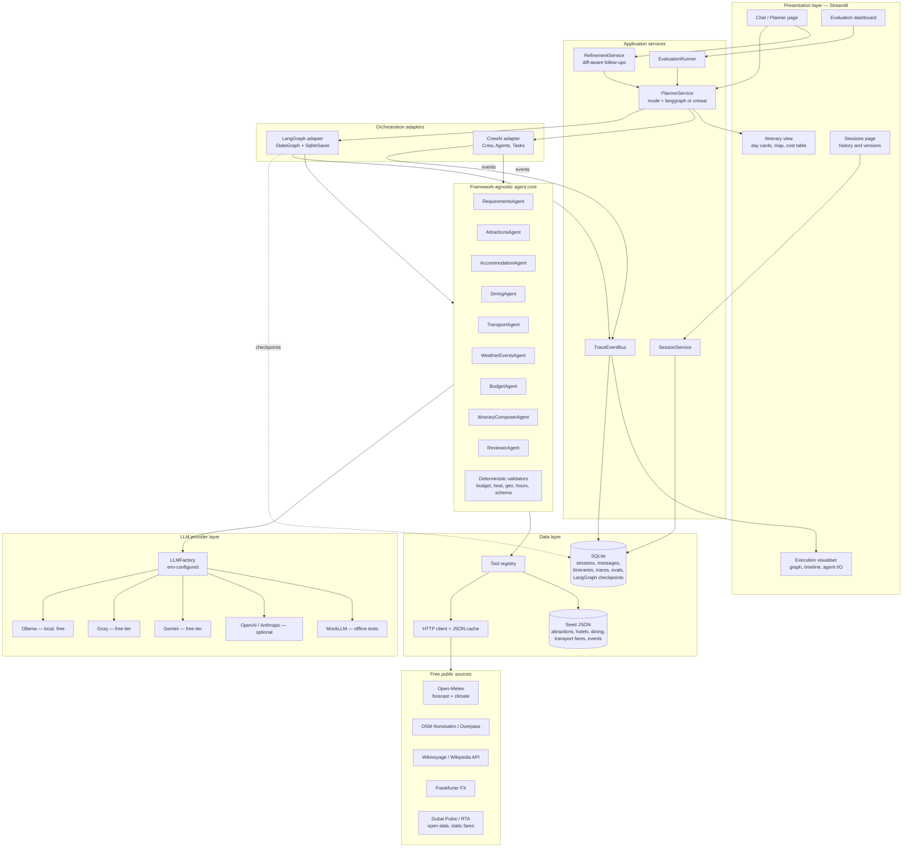
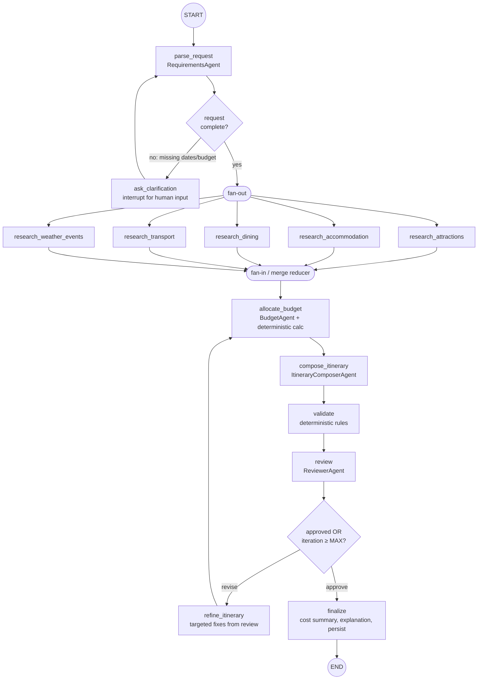
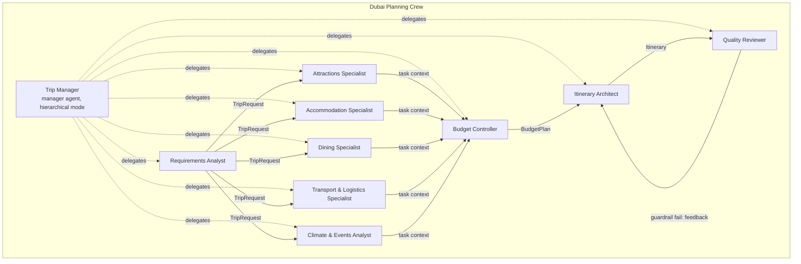
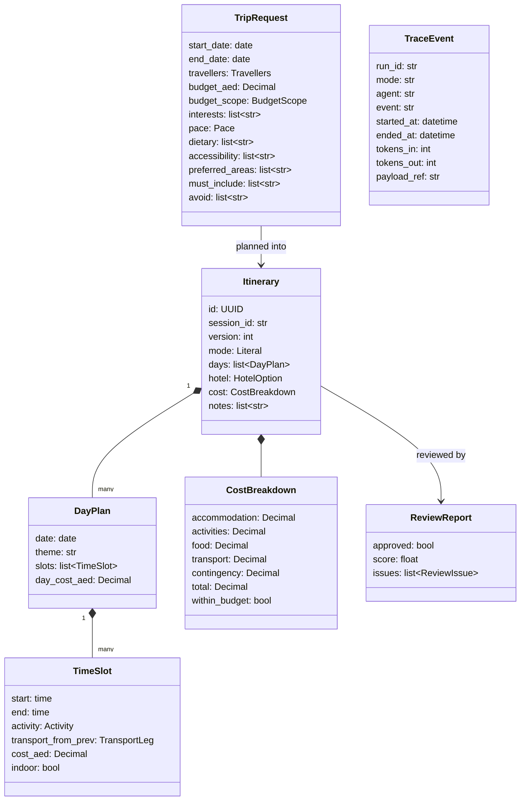
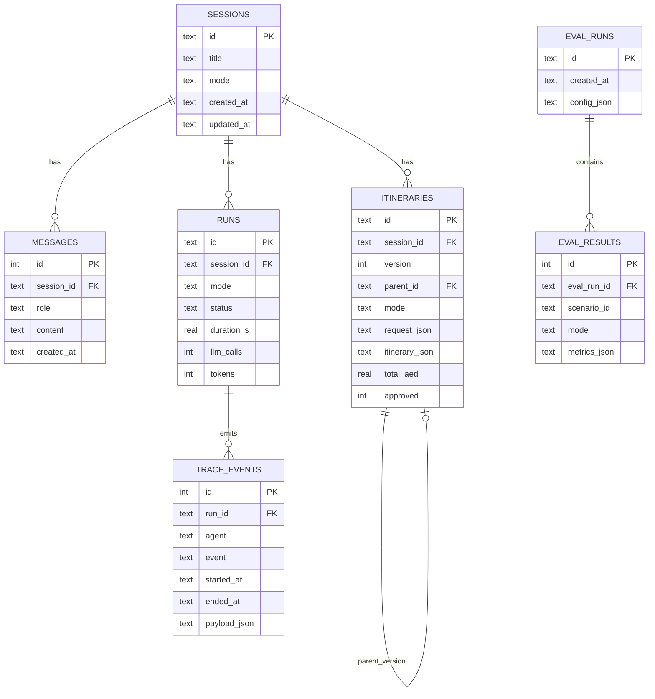
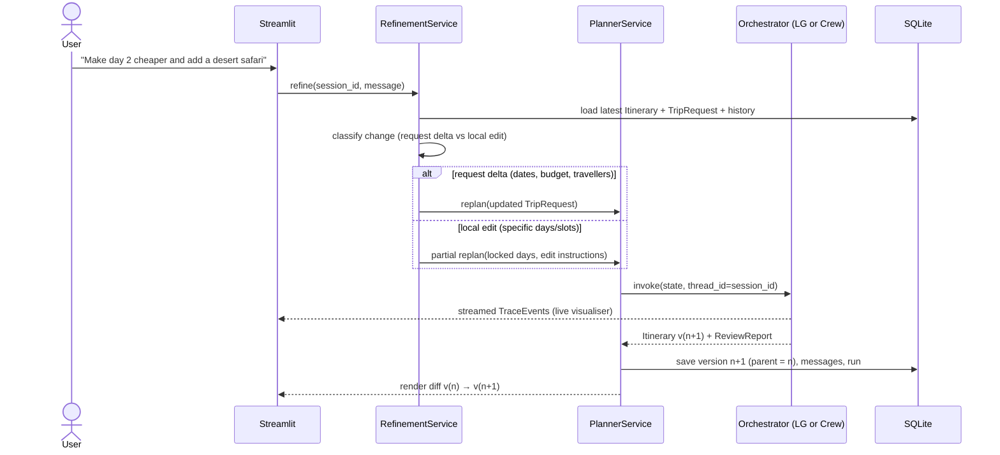

# Architecture — Dubai AI Travel Planner

## 1. Design principles

1. **One domain, two orchestrators.** Agents' *capabilities* (prompts, tools, Pydantic I/O contracts) live in a framework-agnostic core. LangGraph and CrewAI are thin orchestration adapters over the same core, so the evaluation compares orchestration and not different business logic.
2. **Structured everything.** Every agent output is a Pydantic model. LLM text is parsed and validated, and retried on validation failure.
3. **Deterministic where possible.** Budget arithmetic, distance/travel-time estimates, heat rules and schema checks are plain Python, not LLM calls. LLMs pick, rank, write and explain.
4. **Free and offline first.** Keyless public APIs with on-disk JSON caching, curated seed data as fallback, and a mock LLM provider so the full pipeline runs with no network.
5. **Observable by construction.** Every agent step emits a `TraceEvent` to one event bus, which feeds SQLite and the UI visualisation in both modes.

## 2. High-level system diagram



## 3. LangGraph orchestration graph



**State** (`PlannerState`, a `TypedDict` with Pydantic-typed values):

| Key | Type | Reducer |
|-----|------|---------|
| `session_id` | `str` | overwrite |
| `messages` | `list[ChatMessage]` | `add_messages` (append) |
| `request` | `TripRequest \| None` | overwrite |
| `research` | `ResearchBundle` (attractions, hotels, dining, transport, weather, events) | custom merge per key, so parallel branches never collide |
| `budget_plan` | `BudgetPlan` | overwrite |
| `itinerary` | `Itinerary` | overwrite |
| `validation` | `list[RuleViolation]` | overwrite |
| `review` | `ReviewReport` | overwrite |
| `iteration` | `int` | overwrite (incremented by `refine`) |
| `trace` | `list[TraceEvent]` | `operator.add` (append) |

**Parallelism:** the five research nodes come from one fan-out (static edges, or the `Send` API when the number of branches depends on the request, such as one research task per day-trip destination). LangGraph runs them in the same super-step. Their results merge through reducers. Measured speed-up is recorded in the trace.

**Checkpointing:** `SqliteSaver` with `thread_id = session_id`, which enables resume, time travel ("show the version before my last change") and human-in-the-loop clarification through `interrupt`.

*As built (Phase 3).* `orchestration/langgraph/` (generated diagram: `docs/generated/langgraph.mmd`). Differences from the design above:

- **Loop edge:** `refine_itinerary → compose_itinerary` (not `→ allocate_budget`). The budget agent is deterministic for an unchanged request and research, so re-running it would cost an LLM call and change nothing.
- **Targeted refinement** (`agents/revision.py`, shared with CrewAI mode): feedback lines (errors first, bounded) plus `locked_days`. If every blocking issue names a day, all other days are kept verbatim from the previous attempt; a global issue (e.g. `budget.total`) re-plans every day.
- **Termination:** `route_after_review` → `finalize` when the attempt is approved **and** no error-severity rule fails (checked independently of the reviewer), or when `iteration ≥ MAX_REVIEW_ITERATIONS`. `refine` is the only back edge and increments `iteration`. Clarification is capped at 3 rounds (then `finalize` with `needs_clarification`), and `recursion_limit` is derived from both caps as a second stop.
- **State:** as in the table, plus `run_id`, `today`, `user_message`, `draft`, `missing`, `clarification_question`, `clarifications`, `assumptions`, `feedback`, `locked_days`, `best` (an `Attempt`), `attempts` (`AttemptSummary` list), `status`, `saved_version`. `research` uses the custom reducer `merge_research`: each branch writes a partial dict, and `None` resets it for a new request. `messages` is append-only. Trace events go to the bus, not into the state, so checkpoints stay small. A new message on a finished thread starts a new run and keeps `messages` and `draft`; when a clarification is pending, the message becomes `Command(resume=...)`.
- **Best attempt:** the final itinerary is the best attempt (approved, then fewest errors, then highest score). When the cap is reached it is returned and saved **unapproved** with its issues (`PlanStatus.needs_revision`).
- **Nodes** are thin wrappers over the agent core. They run inside the run's trace context, taken from the state (so it is correct in worker threads and after a resume), and emit `start`/`end` events with `payload.kind="node"`. Agents are injected through `AgentSuite` (tests stub them).
- **Errors:** LLM nodes get a bounded `RetryPolicy` for transient provider errors (429, timeout, 5xx, connection). Other errors end the run as `failed`, with a short, secret-free message on `PlanResult.error` and the run record; `resume()` re-runs only the failed node.
- **Durability:** the runner streams with `durability="sync"`. LangGraph's default `async` lost the last branch write when the process was killed (found by the AC3.5 test).
- **Serializer:** `JsonPlusSerializer` with an explicit allowlist of the `dubai_planner.models` classes (`checkpoint.py`), so checkpoints cannot instantiate other classes.
- **Service:** `LangGraphPlanner` (`runner.py`) owns the session, messages, run record (status, LLM calls, tokens) and the saved itinerary version. It yields `PlannerUpdate`s and returns `PlanResult` (`models/planning.py`), the contract CrewAI mode must also return. `run_langgraph(request_text, session_id, stream=True)` wraps it.

## 4. CrewAI collaboration design



- **Agents** have `role`, `goal`, `backstory`, a tool list (wrapping the shared tool registry) and an LLM from `LLMFactory` (LiteLLM model strings, e.g. `ollama/llama3.1`, `groq/llama-3.1-8b-instant`, `gemini/gemini-2.0-flash`).
- **Tasks** declare `expected_output`, `output_pydantic` (same models as LangGraph mode) and `context=[...]` dependencies. Research tasks use `async_execution=True` so they run concurrently.
- **Process**: `Process.sequential` by default (predictable, cheaper). `Process.hierarchical` with a manager agent is a configurable variant evaluated separately.
- **Review loop**: the Itinerary Architect task gets a **task guardrail** that runs deterministic validators plus the Reviewer. A failure returns feedback and CrewAI retries the task (`guardrail_max_retries`). An outer loop in the adapter re-kicks off the compose/review tasks if needed. Both modes share `MAX_REVIEW_ITERATIONS`.
- **Observability**: `step_callback` / `task_callback` plus CrewAI's event listener map to the same `TraceEvent` schema.

## 5. Agent catalogue

| Agent | Input | Output model | Tools | LLM? |
|-------|-------|--------------|-------|------|
| Requirements | user message + session history | `TripRequest` | — | yes (extraction) |
| Attractions | `TripRequest` | `list[AttractionOption]` | seed search, Overpass POIs, Wikivoyage summary | yes (rank/select) |
| Accommodation | `TripRequest` | `list[HotelOption]` | seed hotels by area/price band | yes (rank) |
| Dining | `TripRequest` | `list[DiningOption]` | seed restaurants, Overpass amenity=restaurant | yes (rank) |
| Transport | `TripRequest`, areas | `TransportPlan` | RTA fare table, haversine travel-time estimator | mostly deterministic |
| Weather & Events | dates | `WeatherContext`, `list[EventInfo]` | Open-Meteo forecast/climate, events seed, holiday calendar | light |
| Budget | request + research | `BudgetPlan` (per-category allocation in AED) | currency converter, cost calculator | deterministic + LLM rationale |
| Itinerary Composer | everything above | `Itinerary` (days → time slots) | travel-time estimator | yes |
| Reviewer | `Itinerary`, `TripRequest`, violations | `ReviewReport` (approved, issues[], severity, suggested fixes) | validators | yes |

*As built (Phase 2).* Each agent module exposes `AGENT`, Pydantic I/O models and `run(input, llm, tools)`, where `tools` is a `tools.toolbox.Toolbox` (injectable data sources; `TOOL_SPECS` gives Pydantic argument schemas for Phase 4's CrewAI tool wrappers). Differences from the table above:

- **Requirements** returns `RequirementsResult` (draft, strict request when complete, missing fields, a clarification question, assumptions). The LLM fills a flat `RequirementsExtraction` (`duration_days`, `month`, `budget_amount` + `budget_currency`); Python resolves dates, converts currency via the USD peg, normalises vocabulary and merges with the previous draft. The user's text is wrapped in `<user_request>` and treated as data.
- **Attractions / Accommodation / Dining** share `agents/selection.py`: the search tool filters hard constraints and pre-ranks; the LLM returns `Selection{picks[id, score, rationale]}`. Ids not in the candidate list are **rejected** (dropped, listed in `rejected_ids`, traced as a guardrail event); if none is valid the output is repaired once, then fails loudly. Short lists are topped up from the tool ranking. `fallback=True` (opt-in) uses the tool ranking when the model fails.
- **Transport** and **Weather & Events** are fully deterministic (no LLM call). The Overpass/Wikivoyage clients are available as tools but are not used to *add* venues, because OSM POIs carry no price or dietary data and could not be grounded or costed.
- **Budget**: allocation is deterministic (priority: accommodation, transport, food band, then activities capped to what is left; contingency 10 %). The plan is `feasible=false` with a reason only when even that does not fit `budget × (1 + tolerance)`. The LLM writes only the rationale; on failure a deterministic rationale is used.
- **Composer**: the LLM returns a small `DraftItinerary` (day → slots by id and time). `assemble()` grounds ids, fills venue facts, estimates every leg, prices every slot for the party and builds the cost breakdown; any problem is sent back as the repair message. `locked_days` + `previous` support partial re-planning (Phase 5). `baseline_draft()` is a deterministic heat-, pace-, budget- and opening-hours-aware scheduler (mock reply and opt-in fallback).
- **Reviewer**: rule violations always become issues; `approved` ⇔ no error-severity issue from either rules or LLM; score = min(LLM score, rule ceiling).

## 6. Core domain models (Pydantic v2)



**Data provenance (as built, Phase 1).** Every externally sourced fact carries a `Provenance` (`kind`, `source`, `source_url`, `as_of`, `licence`, `note`). `DataKind` is one of:

| Kind | Meaning | Example |
|------|---------|---------|
| `verified` | checked against an authoritative source; requires `source_url` | AED/USD peg 3.6725 |
| `api` | returned by a live public API on `as_of` | Open-Meteo forecast, Nominatim geocode, Frankfurter rates |
| `curated` | compiled by hand from public info, not re-checked live | venue location, category, indoor/outdoor |
| `estimated` | approximation | every seed price (`PriceRange`), event windows, Hijri-computed holidays, last-year weather proxy |

Seed prices are always `estimated` (enforced by `tests/unit/test_seed.py`), and `PriceRange.label()` renders them as `≈ AED x–y (estimate, as of …)`. Money is the `AED` annotated type: `Decimal`, ≥ 0, quantised to 2 dp half-up. Venue activities (`attraction`, `dining`, `hotel`) must carry a `ref_id`, which grounds them at the contract level. `CostBreakdown` may hold an inconsistent total on purpose, so the `budget.arithmetic` rule can *report* it instead of the pipeline crashing.

## 7. Deterministic validators (shared by both modes)

| Rule | Severity | Description |
|------|----------|-------------|
| `budget.total` | error | `cost.total ≤ budget × (1 + BUDGET_TOLERANCE)` |
| `budget.arithmetic` | error | category sums equal total; day costs sum correctly |
| `time.overlap` | error | no overlapping slots within a day |
| `time.opening_hours` | warning | activity within known opening hours (where data exists) |
| `heat.midday_outdoor` | warning→error (May–Sep) | no outdoor slot 11:00–16:00 when forecast/climatology max > 38 °C |
| `geo.travel_time` | warning | travel leg time plausible; ≤ 90 min per leg unless day trip |
| `pace.density` | warning | slots/day match `pace` (relaxed ≤ 3, moderate ≤ 5, packed ≤ 7) |
| `constraints.dietary` | error | dining options honour dietary flags |
| `constraints.accessibility` | warning | wheelchair-flagged activities only when required |
| `culture.ramadan` | info | daytime eating/drinking etiquette notes when dates overlap Ramadan |
| `grounding.known_entities` | warning | every venue resolves to seed data or a cited source (anti-hallucination) |

*As built (Phase 2):* `validation/rules.py` (`validate_itinerary`, `RULES`, `has_errors`); shared limits live in `validation/thresholds.py` so planner and checker agree. Interpretations: `pace.density` counts sightseeing slots (attractions + events), not meals; `budget.arithmetic` checks category sum = total, item sum = total, each `day_cost_aed` = slot costs + inbound leg costs, and Σ day costs = activities + food + transport; `heat.midday_outdoor` uses the researched weather (forecast/historical) and falls back to seed climatology; `constraints.accessibility` is a warning for venues recorded as inaccessible and info for unknown access; `grounding.known_entities` checks against the research bundle when given (else the seed catalogue). Rules also re-check invariants the models enforce (e.g. overlaps), so itineraries loaded with `model_construct` are still reported on.

## 8. Persistence

**SQLite** (`data/app.db`, created by migrations in `storage/schema.sql`):



LangGraph checkpoints go to a separate `data/checkpoints.db` (owned by `langgraph-checkpoint-sqlite`).

*As built (Phase 1):* `itineraries` also stores `run_id` and `created_at`, with `UNIQUE(session_id, version)`; `messages` has `metadata_json`; `runs` has `started_at`/`ended_at`/`error`; `eval_results` has `seed`. Child rows use `ON DELETE CASCADE`. The schema version lives in `PRAGMA user_version`.

**JSON**: `data/seed/*.json` (curated, versioned, cites sources; as built: `attractions`, `hotels`, `restaurants`, `areas`, `transport`, `events`, `climate`, `holidays`, `fx_rates`, each `{meta, items|data}`), `data/cache/*.json` (HTTP response cache with TTL, git-ignored), `data/exports/*.json|md` (exported itineraries), `eval/scenarios/*.json`.

## 9. Conversational refinement flow



## 10. LLM provider configuration

Selected by environment variables only (see `.env.example`):

```
LLM_PROVIDER=ollama|groq|gemini|openai|anthropic|mock
LLM_MODEL=llama3.1:8b
LLM_TEMPERATURE=0.2
LLM_BASE_URL=http://localhost:11434   # Ollama
GROQ_API_KEY= / GEMINI_API_KEY= / OPENAI_API_KEY= / ANTHROPIC_API_KEY=
```

`LLMFactory` returns (a) a LangChain `BaseChatModel` for LangGraph nodes and (b) a CrewAI `LLM` (LiteLLM string) for crews, both from the same settings. Per-agent overrides are possible (e.g. a smaller model for extraction). `MockLLM` returns fixture-based structured outputs so tests and CI are deterministic and free.

*As built (Phase 2):*

- **Neutral chat interface.** Agents call `llm.base.ChatLLM` (`complete(messages) -> Completion`). `as_chat_llm()` wraps a LangChain chat model (`LangChainChatLLM`) or a CrewAI `BaseLLM` (`CrewAIChatLLM`), so `get_chat_model()` and `get_crewai_llm()` objects go straight into any agent's `run()`.
- **Factory** (`llm/factory.py`): `resolve_spec()` validates config without importing an SDK (a missing key raises `LLMConfigError` naming the env var; a missing package raises `ProviderNotInstalledError` naming it). `LLM_MODEL` empty = per-provider default; `LLM_MODEL__<AGENT>` overrides per agent. Bounded `LLM_TIMEOUT_S` / `LLM_MAX_RETRIES` go to every SDK. CrewAI 1.15 routes Ollama and OpenAI natively. Groq and Gemini go through their **OpenAI-compatible endpoints** (no LiteLLM or extra CrewAI extras needed); Anthropic needs `crewai[anthropic]`.
- **Structured output** (`llm/structured.py`): provider-native `with_structured_output` on the first attempt for real LangChain providers (Groq with `method="json_schema"`; a provider rejection such as Groq's 400 `tool_use_failed` keeps the model's `failed_generation` text and validates it like any other reply); otherwise JSON prompt → fence/prose stripping → `model_validate_json` → agent `postprocess` (semantic checks) → **one** repair turn with the errors → `StructuredOutputError`. Transport errors (`LLMCallError`) are never "repaired". Every call publishes an `llm_call` `TraceEvent` with tokens and latency.
- **Output limits** (Phase 3): `LLM_MAX_TOKENS` and `LLM_REASONING_EFFORT` go to the LangChain providers (as `num_predict` for Ollama, `max_output_tokens` for Gemini). Groq defaults to 4096 tokens and `low` effort for `openai/gpt-oss-*`, because Groq's own 2048-token cap truncated the composer's JSON (AC3.6 finding). Wiring these into CrewAI's `LLM` is **[verify]** in Phase 4.
- **Mock** (`llm/mock.py`): one deterministic engine, exposed as a LangChain chat model (`langchain_mock.MockChatModel`) and as a CrewAI `BaseLLM` (`crewai_mock.MockCrewAILLM`; no LiteLLM). It reads `AGENT:`/`SCHEMA:` markers and the prompt's `<context>` JSON; resolution order is scripted replies (tests) → fixture files → per-schema generators registered by each agent (deterministic baselines such as "top-ranked candidates" or the composer's scheduler).
- **Tracing** (`tracing/bus.py`): a minimal in-process bus with a `ContextVar` run context (`run_id`, `mode`, `iteration`), `agent_span()` (start/end/error) and `capture()` for tests. Phase 6 adds the SQLite and Streamlit subscribers.

## 11. Repository layout

```
dubai-ai-travel-planner/
├── CLAUDE.md, problemStatement.md, architecture.md, research.md, implementationPlan.md
├── README.md                      # quick start (Phase 0)
├── pyproject.toml                 # deps + tool config (Phase 0)
├── .env.example                   # documented env vars, no secrets
├── .gitignore
├── app/                           # Streamlit entry + pages
│   ├── streamlit_app.py
│   └── pages/                     # 1_Planner, 2_Sessions, 3_Execution, 4_Evaluation
├── src/dubai_planner/
│   ├── config.py                  # pydantic-settings
│   ├── models/                    # Pydantic domain models
│   ├── llm/                       # factory, providers, mock, structured-output helpers
│   ├── data/                      # source clients, cache, seed loaders
│   ├── tools/                     # framework-agnostic tool functions
│   ├── agents/                    # agent specs: prompts + I/O contracts + run functions
│   ├── validation/                # deterministic rules
│   ├── orchestration/
│   │   ├── langgraph/             # state, nodes, graph builder
│   │   └── crewai/                # agents.yaml, tasks.yaml, crew builder, guardrails
│   ├── services/                  # planner, session, refinement
│   ├── storage/                   # sqlite repo + schema.sql
│   ├── tracing/                   # TraceEvent bus, adapters for both frameworks
│   └── evaluation/                # metrics, judge, runner, report
├── data/
│   ├── seed/                      # curated JSON (committed)
│   ├── cache/                     # API cache (ignored)
│   └── exports/                   # (ignored)
├── eval/
│   ├── scenarios/                 # benchmark requests (JSON)
│   └── reports/                   # generated reports
├── scripts/                       # seed refresh, run_eval, init_db
└── tests/
    ├── unit/  integration/  fixtures/
```

## 12. Key trade-offs

| Decision | Chosen | Alternative | Reason |
|----------|--------|-------------|--------|
| Shared agent core | yes | separate implementations per framework | fair comparison, less duplication |
| Budget maths | deterministic Python | LLM | LLMs are unreliable at arithmetic |
| Default LLM | Ollama local | hosted paid | free, private, reproducible; slower |
| Hotel/restaurant prices | curated seed bands | scraping booking sites | ToS and legality; no free API |
| Persistence | SQLite + JSON | Postgres/Redis | zero-ops, single file, enough for one user |
| Visualisation | Mermaid from compiled graph + Plotly timeline | LangSmith | free, offline, works for both frameworks |
