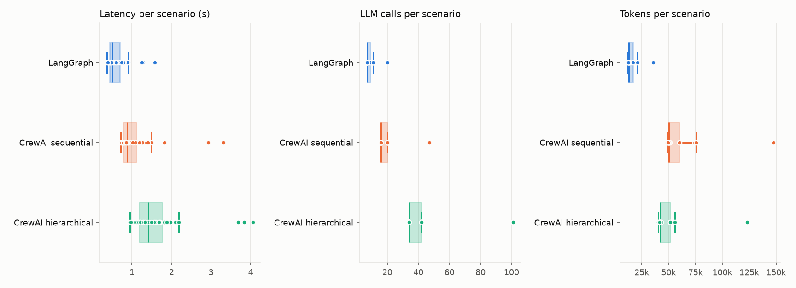
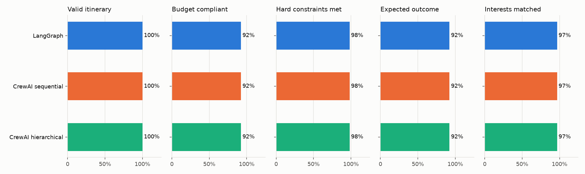

# Evaluation report — LangGraph vs CrewAI (Phase 7)

Date: 2026-11-17. Code: branch `phase-7`. Every number below comes from a generated
report in `eval/results/` (CSV + JSONL + Markdown, reproducible with the command shown)
or from a named test. Nothing was typed in by hand, and missing evidence is marked as
missing.

## 1. What was evaluated, and how

- **Scenarios** (`eval/scenarios/*.json`, 13): budget backpacker, family with two
  children ("no late nights"), luxury honeymoon, summer heat (July), Ramadan, vegetarian
  wheelchair user in July, Abu Dhabi day trip, infeasible budget (AED 400 for two people,
  three days), vague request + clarification, three-turn refinement (budget −20 %, then
  day 2 indoors), vegan + relaxed pace, solo traveller with a USD budget, four friends
  with a packed pace. Expectations are written from the **user's words**, so a parsing
  mistake counts against the mode.
- **Modes**: LangGraph; CrewAI sequential; CrewAI hierarchical (mock only).
- **Same inputs for every mode**: identical scenario text and `today` (2026-11-16), the
  same seed data (fingerprint `1149205102e2`), data sources offline (curated seed), the
  same 11 rules, review cap 2 and budget tolerance 5 %. Each cell runs the conversation
  through the app's own path (`RunManager` → `refinement.classify` → planner → SQLite).
- **Metrics** (`evaluation/metrics.py`, from `research.md §5`): schema validity (S1);
  budget compliance against the user's budget, or an explicit infeasibility explanation
  (S2); hard constraints (days, travellers, dietary, accessibility, pace, heat safety,
  family-friendly, latest end, day trip, indoor days; S3); an independent re-run of the
  rules (errors/warnings); interest match; grounding rate; travel km per day; latency;
  LLM calls; tokens; review iterations; guardrail rejections; research window / sum of
  research durations (S4). Aggregates are mean ± sample standard deviation.
- **Judge** (`evaluation/judge.py`): 1–5 rubric (relevance, feasibility, explanation,
  local insight) and pairwise A/B comparison run in **both orders** (a win counts only
  if both orders agree). With the mock provider the judge is a constant placeholder.
- **Fault injection** (`evaluation/faults.py`): 8 defects corrupt the first composition
  through `AgentSuite(composer=…)`; *detected* = the defect's rule appears in that
  attempt's review verdict; *fixed* = error-severity defect gone and the run approved.

Three evaluation results were produced:

| # | Result | Provider | Command | Folder |
|---|---|---|---|---|
| E1 | Full benchmark, 13 scenarios × 3 modes × 3 repetitions (117 cells) | mock (offline) | `python scripts/run_eval.py --provider mock --hierarchical --seeds 3 --judge --faults --out eval/results/mock-benchmark` | `eval/results/mock-benchmark/` |
| E2 | Fault injection, 8 defects × 3 modes | mock (offline) | part of E1 (`--faults`) | `eval/results/mock-benchmark/faults.csv` |
| E3 | Quota-bounded real-model subset, 3 scenarios × LangGraph + CrewAI sequential | Groq `openai/gpt-oss-20b`, judge `openai/gpt-oss-120b` | `LLM_MODEL__JUDGE=openai/gpt-oss-120b python scripts/run_eval.py --provider groq --scenarios budget_backpacker family_kids vegetarian_wheelchair_july --judge --no-faults --no-warmup --max-tokens 140000 --db data/eval_groq.db --out eval/results/groq-subset` | `eval/results/groq-subset/` |

> **E1 and E2 use the deterministic mock LLM.** They prove orchestration behaviour
> (routing, review loop, parallelism, contract validity) on identical inputs. They are
> not evidence of real-model quality: mock token counts are prompt-length estimates and
> mock latencies are not model latencies. Only E3 used a real model.

## 2. E1 — full benchmark (mock provider, offline)

13 scenarios × 3 modes × 3 repetitions = 117 cells, eval run
`bd7d7f60a617439d858b44625b01d61a`, one unscored warm-up run per mode, judge on (mock
placeholder). Full tables, per-scenario rows and charts:
`eval/results/mock-benchmark/report.md`.

| Metric (mean ± sample std, n = 39 per mode) | LangGraph | CrewAI sequential | CrewAI hierarchical |
|---|---|---|---|
| Valid itinerary (S1) | 1.00 ± 0.00 | 1.00 ± 0.00 | 1.00 ± 0.00 |
| Budget compliant (S2) | 0.92 ± 0.27 | 0.92 ± 0.27 | 0.92 ± 0.27 |
| Hard constraints satisfied (S3) | 0.98 ± 0.07 | 0.98 ± 0.07 | 0.98 ± 0.07 |
| Expected outcome | 0.92 ± 0.27 | 0.92 ± 0.27 | 0.92 ± 0.27 |
| Rule errors / warnings in the final plan | 0.15 / 0.00 | 0.15 / 0.00 | 0.15 / 0.00 |
| Interest match (n = 30) | 0.97 ± 0.10 | 0.97 ± 0.10 | 0.97 ± 0.10 |
| Grounded venues | 1.00 | 1.00 | 1.00 |
| Review iterations | 0.31 ± 0.73 | 0.31 ± 0.73 | 0.31 ± 0.73 |
| Guardrail rejections | 0.00 | 0.31 ± 0.73 | 0.31 ± 0.73 |
| **LLM calls** | **8.77 ± 3.60** | **19.31 ± 8.27** | **41.00 ± 17.87** |
| Tokens (mock estimate) | 16 060 ± 6 446 | 62 170 ± 26 536 | 51 021 ± 21 674 |
| Latency (s, mock) | 0.61 ± 0.27 | 1.10 ± 0.62 | 1.63 ± 0.73 |
| Research window / sum of durations (S4: < 0.6) | 0.30 ± 0.08 | 0.23 ± 0.01 | 1.03 ± 0.01 |

Reading E1:

- **Plan quality is identical across modes**, by construction: every mode runs the same
  shared agent core and the mock is deterministic. The differences are orchestration
  cost: CrewAI sequential makes 2.2x and hierarchical 4.7x the LLM calls of LangGraph
  (role reasoning; the hierarchical manager delegates every task), and CrewAI prompts
  are about 3-4x larger (task context and inlined output schemas; hierarchical tasks
  declare no `output_pydantic`, hence fewer tokens than sequential).
- **Parallelism:** LangGraph research and the CrewAI async tasks overlap (window about
  0.23-0.30 of the summed durations); hierarchical mode runs research one task at a time
  (1.03).
- **Failures are shared by all modes**, so they are limitations of the core, not of an
  orchestrator: `family_kids` misses "no late nights" (dinner ends at 22:00; the request
  model has no latest-end field), and `friends_packed` (4 adults, packed pace) ends
  **5.6 % over budget**, unapproved (`needs_revision`): food for four exceeds the
  allocation and the mock composer ignores the reviewer's budget feedback. Before the
  composer fix (section 8) this overshoot was 21.4 %.
- `tight_budget_infeasible` is handled as intended in every mode: over budget, unapproved
  after the review cap, with the budget agent's explicit infeasibility explanation.

## 3. E3 — real model (Groq free tier), quota-bounded

| Scenario | Mode | Status | Total / budget (AED) | Constraints | Latency | LLM calls | Tokens | Judge (1–5) |
|---|---|---|---|---|---|---|---|---|
| budget_backpacker | LangGraph | approved | 2 337.79 / 3 000 | 2/2 | 118.9 s | 8 | 23 455 | 4.75 |
| budget_backpacker | CrewAI sequential | **failed**: HTTP 413, one request of 8 561 tokens > 8 000 tokens/min cap | — | — | 239.0 s | 12 | 32 052 | — |
| family_kids | LangGraph | approved | 7 657.06 / 12 000 | 4/4 (incl. no slot after 21:30) | 140.6 s | 7 | 19 554 | 4.00 |
| family_kids | CrewAI sequential | **failed**: HTTP 429, daily quota (200 000 tokens/day) reached | — | — | 246.5 s | 12 | 32 301 | — |
| vegetarian_wheelchair_july | both | **not run** (daily quota) | | | | | | |

Latency, calls and tokens of failed cells are up to the failure. Research window / sum
of research durations: LangGraph 0.79 and 0.94, i.e. **little overlap**: the three
LLM-backed research agents start together, exceed the 8 000 tokens/min limit together,
get HTTP 429 and are retried by the bounded backoff one after another. Pairwise judging
was not possible (no CrewAI itinerary).

What E3 shows:

- With a real model, LangGraph produced approved, within-budget, constraint-satisfying
  plans (the family plan also respected "no late nights", which the mock baseline does
  not), judged 4.75 and 4.00 by a larger model from the same family (gpt-oss-120b; a
  same-family judge may be lenient towards its sibling).
- CrewAI sequential **could not complete on this free tier**: its per-request prompts
  (role/backstory, task context with upstream briefs, inlined output schemas) plus the
  reserved 4 096 output tokens exceed Groq's per-request cap of 8 000 tokens/min for the
  4-day trip. The Phase 4 smoke run (3-day trip) did fit and was approved in 297.6 s with
  ≈ 46.6k tokens. Lowering `LLM_MAX_TOKENS` for both modes, trimming the inlined schemas,
  a paid tier or a local model would remove this limit; none was applied mid-evaluation,
  to keep the comparison on identical settings.
- **AC7.2 is not met**: ≥ 10 scenarios × 2 modes on a real model needs ≈ 10 × (≈ 20k +
  ≈ 47k) ≈ 670k tokens, more than three days of this free tier, and CrewAI sequential
  first needs the per-request fix. The runner is ready: `python scripts/run_eval.py
  --resume 2bc6aee3a72e44869e4d57d7f8fcf6d5 --db data/eval_groq.db` continues the same
  eval run.

## 4. E2 — fault injection (review loop)

Eight defects × three modes (24 runs; `eval/results/mock-benchmark/faults.csv`; also
`tests/integration/test_evaluation_runs.py::test_ac74_review_loop_detects_seeded_defects`):

| Defect | Rule | Severity | LangGraph | CrewAI seq. | CrewAI hier. |
|---|---|---|---|---|---|
| over budget (suite upgrade worth the whole budget) | `budget.total` | error | detected, fixed (1 iteration) | detected, fixed | detected, fixed |
| category sum differs from total | `budget.arithmetic` | error | detected, fixed | detected, fixed | detected, fixed |
| outdoor slot 12:00-13:30 in July | `heat.midday_outdoor` | error | detected, fixed | detected, fixed | detected, fixed |
| non-vegetarian restaurant for a vegetarian | `constraints.dietary` | error | detected, fixed | detected, fixed | detected, fixed |
| visit before opening time | `time.opening_hours` | warning | detected | detected | detected |
| 150-minute city transfer | `geo.travel_time` | warning | detected | detected | detected |
| invented venue id | `grounding.known_entities` | warning | detected | detected | detected |
| 4 extra visits on a relaxed-pace day | `pace.density` | warning | detected | detected | detected |

**Detection 100 % and repair of error-severity defects 100 % in every mode** (AC7.4;
S5 asks for at least 80 %). LangGraph detects in the `review` node's report; CrewAI in
the compose guardrail (errors are rejected before the reviewer runs) or in the review
report (warnings). Detection comes from the deterministic rules that both reviewers
merge; with the mock, the LLM reviewer adds nothing, so this measures the loop, not an
LLM's judgement. Warnings do not block approval by design. Not injectable:
`constraints.accessibility` (no seed venue is recorded as inaccessible) and
`time.overlap` (the Pydantic model rejects overlapping slots before any reviewer sees
them).

## 5. Hypotheses from `research.md §1.3`

| Hypothesis | Verdict | Evidence |
|---|---|---|
| Latency: LangGraph lower | **Held** | Mock 0.61 s vs 1.10 s (sequential) and 1.63 s (hierarchical); Groq 119-141 s vs at least 239 s for CrewAI cells that never finished |
| LLM calls / tokens: CrewAI higher (hierarchical highest in calls) | **Held** | Mock calls 8.8 / 19.3 / 41.0; Groq: LangGraph 7-8 calls and about 21.5k tokens for a complete plan, CrewAI 12 calls and about 32k tokens *before failing* (Phase 4 complete run: about 46.6k) |
| Output validity: LangGraph at least as good with small models | **Held, for a different reason than expected** | Groq: LangGraph 2/2 valid, CrewAI 0/2. The cause was not invalid JSON but CrewAI's larger requests exceeding the free tier's per-request limit (HTTP 413) and the daily quota |
| Narrative quality: CrewAI comparable or higher | **Not tested** | No CrewAI real-model itinerary exists; the mock judge is a placeholder. LangGraph's real plans scored 4.75 and 4.00 (gpt-oss-120b) |
| Developer effort for loops: LangGraph lower | **Held (qualitative)** | LangGraph's loop is one conditional edge (`route_after_review`, 13 lines) plus a refine node; CrewAI needed task guardrails (120 lines), an outer revision crew, an iteration budget shared on a run board, and workarounds for swallowed tool errors. Adapter size: 899 vs 1 595 non-blank lines including YAML |

## 6. Success criteria S1–S8 (`problemStatement.md §7`)

| # | Criterion | Status | Evidence |
|---|---|---|---|
| S1 | 100 % of runs produce a valid `Itinerary` | **Met with the mock; not met on the real free tier** | Mock 117/117 (all modes). Groq: LangGraph 2/2; CrewAI sequential 0/2 (HTTP 413 and daily quota; failed runs return no itinerary) |
| S2 | At least 90 % within budget + 5 % or explained | **Met** (mock 92 % = 12/13 per mode; Groq LangGraph 2/2) | `friends_packed` 5.6 % over without an explanation; `tight_budget_infeasible` explained |
| S3 | At least 85 % of hard constraints | **Met** (mock 98 %; Groq LangGraph 6/6) | Mock failure: "no late nights" in `family_kids` |
| S4 | Research wall-clock below 0.6 × sum of node durations | **Met under controlled conditions; not met on the Groq free tier** | AC3.2/AC6.1 (agents stubbed to 1 s: under 1.8 s instead of 5 s); mock benchmark 0.30; Groq 0.79 and 0.94 (the per-minute limit serialises the calls) |
| S5 | At least 80 % of injected defects caught | **Met** | 100 % (24/24), every error defect repaired, all three modes (E2) |
| S6 | Sessions survive restart; refinements create linked versions | **Met** | Transcripts (reopened in a new process: 6/6 and 5/5 checks), AC5.2, AC6.5 |
| S7 | Graph and per-run timeline in the UI for both modes | **Met** | AC6.1-AC6.5 (Execution page) |
| S8 | Comparative report across at least 10 scenarios for both modes | **Met with the mock; real-model comparison incomplete** | E1: 13 scenarios × 3 modes, tables and charts; E3 covers 2 scenarios and CrewAI failed both |

## 7. Session persistence and refinement (transcript)

`scripts/session_transcript.py` (mock provider) played: original request → "reduce the
budget by 20%" (`request_delta`, AED 6000 → 4800 resolved in Python) → "Replace day 2
with indoor activities" (`local_edit`, days 1 and 3 locked and identical, day 2 indoor
only) → "We are vegetarian now…" (`general_change`, every restaurant vegetarian-friendly),
then closed the app and reopened the database **in a new process**: chat history,
versions v1–v4 with parent links, the latest itinerary, run records and (LangGraph) the
checkpoint thread were identical (6/6 checks; CrewAI 5/5). Files:
`docs/transcripts/session_langgraph.md`, `docs/transcripts/session_crewai_sequential.md`.

## 8. Findings fixed during the evaluation

- **Composer budget bug** (shared core, both modes): the deterministic scheduler checked
  each attraction against the amount spent at the *start of the day*, so a packed day of
  individually affordable attractions overshot the activity budget (scenario
  `friends_packed`: 21 % over budget, unapproved after 3 identical attempts). Now
  cumulative; covered by the benchmark.
- **Offline parser bugs** (mock only): "include a day trip" made the budget per-day
  (AED 9000 → 36 000), and "kids aged 6 and 9, 5 days" produced a third child aged 5.
  Regression test `test_heuristic_day_trip_and_trip_length_are_not_misread`.
- **Account ids in recorded errors**: Groq's rate-limit messages name the organisation;
  results now scrub key values and account ids before they are stored or published.

## 9. Limitations and future work

- Complete AC7.2 on a real model: run the remaining cells with `--resume` over several
  days, or with Ollama (`qwen2.5:7b`) / a paid tier; repeat cells (N = 3) for variance.
- Make CrewAI fit small per-request limits: drop inlined `output_pydantic` schemas from
  agent prompts (the guardrail already attaches the typed model) or cap output tokens
  per role.
- Rate-aware parallelism: a shared token bucket so parallel branches wait instead of
  failing and retrying.
- Model "no late nights" and must-include day trips as request fields; preserve earlier
  local edits across general changes; record wheelchair-inaccessible venues.
- Use a judge from a different model family, and report inter-judge agreement.
