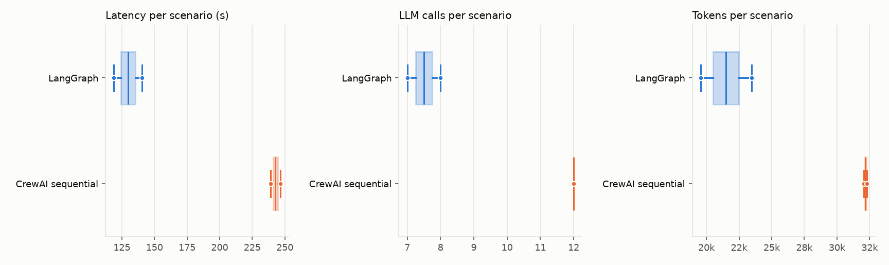
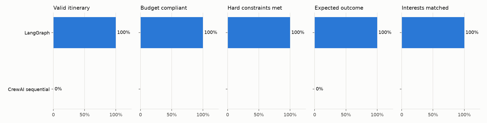

# Evaluation report — Groq gpt-oss-20b, quota-bounded subset

> **Real provider:** `groq` / `openai/gpt-oss-20b`. Each cell is one run (no repetition unless seeds > 1); free-tier rate limits add waiting time to latency.

## Configuration

| Setting | Value |
|---|---|
| Eval run id | `2bc6aee3a72e44869e4d57d7f8fcf6d5` |
| Started (UTC) | 2026-11-17 07:55 |
| Provider / model | `groq` / `openai/gpt-oss-20b` |
| Modes | LangGraph, CrewAI sequential |
| Scenarios | 3 (budget_backpacker, family_kids, vegetarian_wheelchair_july) |
| Seeds (repetitions) | 1 |
| Data | seed fingerprint `1149205102e2`, HTTP offline = True |
| Review-iteration cap / budget tolerance | 2 / 0.05 |
| Judge | on (`openai/gpt-oss-120b`) |
| Token budget | 140000 |
| Unscored warm-up run per mode | False |

## Incomplete

Stopped: provider daily token quota reached; continue another day with --resume 2bc6aee3a72e44869e4d57d7f8fcf6d5. Cells not run (2): vegetarian_wheelchair_july/langgraph/s0, vegetarian_wheelchair_july/crewai_sequential/s0

## Summary per mode (mean ± sample std, n = cells with a value)

| Metric | LangGraph | CrewAI sequential |
|---|---|---|
| Valid itinerary (share) | 1.00 ± 0.00 (n=2) | 0.00 ± 0.00 (n=2) |
| Budget compliant (share) | 1.00 ± 0.00 (n=2) | — |
| Expected outcome (share) | 1.00 ± 0.00 (n=2) | 0.00 ± 0.00 (n=2) |
| Hard constraints satisfied (share) | 1.00 ± 0.00 (n=2) | — |
| Total vs budget (%) | -29.13 ± 9.98 (n=2) | — |
| Rule errors | 0.00 ± 0.00 (n=2) | — |
| Rule warnings | 0.00 ± 0.00 (n=2) | — |
| Interest match (share) | 1.00 ± 0.00 (n=2) | — |
| Grounded venues (share) | 1.00 ± 0.00 (n=2) | — |
| Travel per day (km) | 44.02 ± 11.62 (n=2) | — |
| Latency (s) | 129.73 ± 15.36 (n=2) | 242.73 ± 5.30 (n=2) |
| LLM calls | 7.50 ± 0.71 (n=2) | 12.00 ± 0.00 (n=2) |
| Tokens | 21504.50 ± 2758.42 (n=2) | 32176.50 ± 176.07 (n=2) |
| Review iterations | 0.00 ± 0.00 (n=2) | 0.00 ± 0.00 (n=2) |
| Guardrail rejections | 0.00 ± 0.00 (n=2) | 0.00 ± 0.00 (n=2) |
| Research window / sum | 0.86 ± 0.11 (n=2) | 0.44 ± 0.02 (n=2) |
| Judge score (1-5) | 4.38 ± 0.53 (n=2) | — |

Shares are fractions of cells (1.00 = every cell). *Total vs budget* is (total − budget) / budget; negative = under budget.

## Per scenario

| Scenario | Mode | Status | Expected outcome met | Total / budget (AED) | Constraints met | Rule errors / warnings | Latency (s) | LLM calls | Tokens | Review iterations |
|---|---|---|---|---|---|---|---|---|---|---|
| budget_backpacker | CrewAI sequential | failed | no | — | — | — / — | 239.0 | 12 | 32052 | 0 |
| budget_backpacker | LangGraph | approved | yes | 2337.79 / 3000 | 2/2 | 0 / 0 | 118.9 | 8 | 23455 | 0 |
| family_kids | CrewAI sequential | failed | no | — | — | — / — | 246.5 | 12 | 32301 | 0 |
| family_kids | LangGraph | approved | yes | 7657.06 / 12000 | 4/4 | 0 / 0 | 140.6 | 7 | 19554 | 0 |

## Constraint failures and errors

- **budget_backpacker · CrewAI sequential**: error: APIStatusError: Error code: 413 - {'error': {'message': 'Request too large for model `openai/gpt-oss-20b` in organization `org_***` service tier `on_demand` on tokens per minute (TPM): Limit 8000, Req
- **family_kids · CrewAI sequential**: error: RateLimitError: Error code: 429 - {'error': {'message': 'Rate limit reached for model `openai/gpt-oss-20b` in organization `org_***` service tier `on_demand` on tokens per day (TPD): Limit 200000, Use

## Multi-turn routing

- none

## Pairwise judge (position-swapped)

Not run.

## Fault injection (review loop)

Not run.
