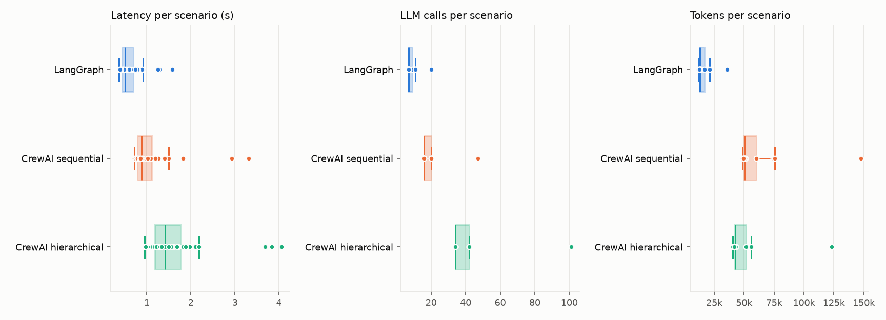
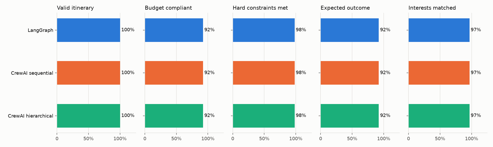

# Evaluation report — Offline mock benchmark (all modes)

> **Mock provider.** These runs use the deterministic offline mock LLM. They show how each orchestration mode behaves (routing, review loop, parallelism, validity of the contract) on identical inputs. They are **not** evidence of real-model quality: the mock's token counts are prompt-length estimates, its latencies are not model latencies, and mock judge scores are a constant placeholder.

## Configuration

| Setting | Value |
|---|---|
| Eval run id | `bd7d7f60a617439d858b44625b01d61a` |
| Started (UTC) | 2026-11-17 08:19 |
| Provider / model | `mock` / `mock` |
| Modes | LangGraph, CrewAI sequential, CrewAI hierarchical |
| Scenarios | 13 (budget_backpacker, family_kids, luxury_honeymoon, summer_heat, ramadan, vegetarian_wheelchair_july, day_trip_abu_dhabi, tight_budget_infeasible, vague_request, multi_refinement, vegan_relaxed, solo_usd_budget, friends_packed) |
| Seeds (repetitions) | 3 |
| Data | seed fingerprint `1149205102e2`, HTTP offline = True |
| Review-iteration cap / budget tolerance | 2 / 0.05 |
| Judge | on |
| Token budget | none |
| Unscored warm-up run per mode | True |

## Summary per mode (mean ± sample std, n = cells with a value)

| Metric | LangGraph | CrewAI sequential | CrewAI hierarchical |
|---|---|---|---|
| Valid itinerary (share) | 1.00 ± 0.00 (n=39) | 1.00 ± 0.00 (n=39) | 1.00 ± 0.00 (n=39) |
| Budget compliant (share) | 0.92 ± 0.27 (n=39) | 0.92 ± 0.27 (n=39) | 0.92 ± 0.27 (n=39) |
| Expected outcome (share) | 0.92 ± 0.27 (n=39) | 0.92 ± 0.27 (n=39) | 0.92 ± 0.27 (n=39) |
| Hard constraints satisfied (share) | 0.98 ± 0.07 (n=39) | 0.98 ± 0.07 (n=39) | 0.98 ± 0.07 (n=39) |
| Total vs budget (%) | 74.84 ± 342.35 (n=39) | 74.84 ± 342.35 (n=39) | 74.84 ± 342.35 (n=39) |
| Rule errors | 0.15 ± 0.37 (n=39) | 0.15 ± 0.37 (n=39) | 0.15 ± 0.37 (n=39) |
| Rule warnings | 0.00 ± 0.00 (n=39) | 0.00 ± 0.00 (n=39) | 0.00 ± 0.00 (n=39) |
| Interest match (share) | 0.97 ± 0.10 (n=30) | 0.97 ± 0.10 (n=30) | 0.97 ± 0.10 (n=30) |
| Grounded venues (share) | 1.00 ± 0.00 (n=39) | 1.00 ± 0.00 (n=39) | 1.00 ± 0.00 (n=39) |
| Travel per day (km) | 60.08 ± 29.39 (n=39) | 60.08 ± 29.39 (n=39) | 60.08 ± 29.39 (n=39) |
| Latency (s) | 0.61 ± 0.27 (n=39) | 1.10 ± 0.62 (n=39) | 1.63 ± 0.73 (n=39) |
| LLM calls | 8.77 ± 3.60 (n=39) | 19.31 ± 8.27 (n=39) | 41.00 ± 17.87 (n=39) |
| Tokens | 16059.85 ± 6445.83 (n=39) | 62170.38 ± 26536.33 (n=39) | 51021.38 ± 21674.40 (n=39) |
| Review iterations | 0.31 ± 0.73 (n=39) | 0.31 ± 0.73 (n=39) | 0.31 ± 0.73 (n=39) |
| Guardrail rejections | 0.00 ± 0.00 (n=39) | 0.31 ± 0.73 (n=39) | 0.31 ± 0.73 (n=39) |
| Research window / sum | 0.30 ± 0.08 (n=39) | 0.23 ± 0.01 (n=39) | 1.03 ± 0.01 (n=39) |
| Judge score (1-5) | 3.00 ± 0.00 (n=39) | 3.00 ± 0.00 (n=39) | 3.00 ± 0.00 (n=39) |

Shares are fractions of cells (1.00 = every cell). *Total vs budget* is (total − budget) / budget; negative = under budget.

## Per scenario

| Scenario | Mode | Status | Expected outcome met | Total / budget (AED) | Constraints met | Rule errors / warnings | Latency (s) | LLM calls | Tokens | Review iterations |
|---|---|---|---|---|---|---|---|---|---|---|
| budget_backpacker | CrewAI hierarchical | approved | yes | 2034.08 / 3000 | 2/2 | 0 / 0 | 1.0 | 34 | 42192 | 0 |
| budget_backpacker (s1) | CrewAI hierarchical | approved | yes | 2034.08 / 3000 | 2/2 | 0 / 0 | 1.2 | 34 | 42192 | 0 |
| budget_backpacker (s2) | CrewAI hierarchical | approved | yes | 2034.08 / 3000 | 2/2 | 0 / 0 | 1.4 | 34 | 42192 | 0 |
| budget_backpacker | CrewAI sequential | approved | yes | 2034.08 / 3000 | 2/2 | 0 / 0 | 0.8 | 16 | 50249 | 0 |
| budget_backpacker (s1) | CrewAI sequential | approved | yes | 2034.08 / 3000 | 2/2 | 0 / 0 | 0.7 | 16 | 50249 | 0 |
| budget_backpacker (s2) | CrewAI sequential | approved | yes | 2034.08 / 3000 | 2/2 | 0 / 0 | 0.7 | 16 | 50249 | 0 |
| budget_backpacker | LangGraph | approved | yes | 2034.08 / 3000 | 2/2 | 0 / 0 | 0.5 | 7 | 13040 | 0 |
| budget_backpacker (s1) | LangGraph | approved | yes | 2034.08 / 3000 | 2/2 | 0 / 0 | 0.4 | 7 | 13040 | 0 |
| budget_backpacker (s2) | LangGraph | approved | yes | 2034.08 / 3000 | 2/2 | 0 / 0 | 0.5 | 7 | 13040 | 0 |
| day_trip_abu_dhabi | CrewAI hierarchical | approved | yes | 7523.76 / 9000 | 3/3 | 0 / 0 | 1.1 | 34 | 42830 | 0 |
| day_trip_abu_dhabi (s1) | CrewAI hierarchical | approved | yes | 7523.76 / 9000 | 3/3 | 0 / 0 | 2.1 | 34 | 42830 | 0 |
| day_trip_abu_dhabi (s2) | CrewAI hierarchical | approved | yes | 7523.76 / 9000 | 3/3 | 0 / 0 | 1.2 | 34 | 42830 | 0 |
| day_trip_abu_dhabi | CrewAI sequential | approved | yes | 7523.76 / 9000 | 3/3 | 0 / 0 | 0.7 | 16 | 50598 | 0 |
| day_trip_abu_dhabi (s1) | CrewAI sequential | approved | yes | 7523.76 / 9000 | 3/3 | 0 / 0 | 0.9 | 16 | 50598 | 0 |
| day_trip_abu_dhabi (s2) | CrewAI sequential | approved | yes | 7523.76 / 9000 | 3/3 | 0 / 0 | 0.8 | 16 | 50598 | 0 |
| day_trip_abu_dhabi | LangGraph | approved | yes | 7523.76 / 9000 | 3/3 | 0 / 0 | 0.6 | 7 | 13263 | 0 |
| day_trip_abu_dhabi (s1) | LangGraph | approved | yes | 7523.76 / 9000 | 3/3 | 0 / 0 | 0.5 | 7 | 13263 | 0 |
| day_trip_abu_dhabi (s2) | LangGraph | approved | yes | 7523.76 / 9000 | 3/3 | 0 / 0 | 0.4 | 7 | 13263 | 0 |
| family_kids | CrewAI hierarchical | approved | yes | 10968.47 / 12000 | 3/4 | 0 / 0 | 1.2 | 34 | 43111 | 0 |
| family_kids (s1) | CrewAI hierarchical | approved | yes | 10968.47 / 12000 | 3/4 | 0 / 0 | 1.1 | 34 | 43111 | 0 |
| family_kids (s2) | CrewAI hierarchical | approved | yes | 10968.47 / 12000 | 3/4 | 0 / 0 | 1.1 | 34 | 43111 | 0 |
| family_kids | CrewAI sequential | approved | yes | 10968.47 / 12000 | 3/4 | 0 / 0 | 0.9 | 16 | 51034 | 0 |
| family_kids (s1) | CrewAI sequential | approved | yes | 10968.47 / 12000 | 3/4 | 0 / 0 | 0.8 | 16 | 51034 | 0 |
| family_kids (s2) | CrewAI sequential | approved | yes | 10968.47 / 12000 | 3/4 | 0 / 0 | 0.9 | 16 | 51034 | 0 |
| family_kids | LangGraph | approved | yes | 10968.47 / 12000 | 3/4 | 0 / 0 | 0.9 | 7 | 13788 | 0 |
| family_kids (s1) | LangGraph | approved | yes | 10968.47 / 12000 | 3/4 | 0 / 0 | 0.4 | 7 | 13788 | 0 |
| family_kids (s2) | LangGraph | approved | yes | 10968.47 / 12000 | 3/4 | 0 / 0 | 0.8 | 7 | 13788 | 0 |
| friends_packed | CrewAI hierarchical | needs_revision | no | 12672.79 / 12000 | 3/3 | 1 / 0 | 1.6 | 42 | 55706 | 2 |
| friends_packed (s1) | CrewAI hierarchical | needs_revision | no | 12672.79 / 12000 | 3/3 | 1 / 0 | 1.9 | 42 | 55706 | 2 |
| friends_packed (s2) | CrewAI hierarchical | needs_revision | no | 12672.79 / 12000 | 3/3 | 1 / 0 | 1.5 | 42 | 55706 | 2 |
| friends_packed | CrewAI sequential | needs_revision | no | 12672.79 / 12000 | 3/3 | 1 / 0 | 1.5 | 20 | 75558 | 2 |
| friends_packed (s1) | CrewAI sequential | needs_revision | no | 12672.79 / 12000 | 3/3 | 1 / 0 | 1.4 | 20 | 75558 | 2 |
| friends_packed (s2) | CrewAI sequential | needs_revision | no | 12672.79 / 12000 | 3/3 | 1 / 0 | 1.2 | 20 | 75558 | 2 |
| friends_packed | LangGraph | needs_revision | no | 12672.79 / 12000 | 3/3 | 1 / 0 | 0.7 | 11 | 20962 | 2 |
| friends_packed (s1) | LangGraph | needs_revision | no | 12672.79 / 12000 | 3/3 | 1 / 0 | 0.8 | 11 | 20962 | 2 |
| friends_packed (s2) | LangGraph | needs_revision | no | 12672.79 / 12000 | 3/3 | 1 / 0 | 0.7 | 11 | 20962 | 2 |
| luxury_honeymoon | CrewAI hierarchical | approved | yes | 15245.93 / 25000 | 2/2 | 0 / 0 | 1.3 | 34 | 42404 | 0 |
| luxury_honeymoon (s1) | CrewAI hierarchical | approved | yes | 15245.93 / 25000 | 2/2 | 0 / 0 | 1.0 | 34 | 42404 | 0 |
| luxury_honeymoon (s2) | CrewAI hierarchical | approved | yes | 15245.93 / 25000 | 2/2 | 0 / 0 | 1.7 | 34 | 42404 | 0 |
| luxury_honeymoon | CrewAI sequential | approved | yes | 15245.93 / 25000 | 2/2 | 0 / 0 | 0.8 | 16 | 50344 | 0 |
| luxury_honeymoon (s1) | CrewAI sequential | approved | yes | 15245.93 / 25000 | 2/2 | 0 / 0 | 0.8 | 16 | 50344 | 0 |
| luxury_honeymoon (s2) | CrewAI sequential | approved | yes | 15245.93 / 25000 | 2/2 | 0 / 0 | 0.9 | 16 | 50344 | 0 |
| luxury_honeymoon | LangGraph | approved | yes | 15245.93 / 25000 | 2/2 | 0 / 0 | 0.5 | 7 | 13091 | 0 |
| luxury_honeymoon (s1) | LangGraph | approved | yes | 15245.93 / 25000 | 2/2 | 0 / 0 | 0.4 | 7 | 13091 | 0 |
| luxury_honeymoon (s2) | LangGraph | approved | yes | 15245.93 / 25000 | 2/2 | 0 / 0 | 0.5 | 7 | 13091 | 0 |
| multi_refinement | CrewAI hierarchical | approved | yes | 3254.99 / 4800 | 3/3 | 0 / 0 | 3.8 | 101 | 123025 | 0 |
| multi_refinement (s1) | CrewAI hierarchical | approved | yes | 3254.99 / 4800 | 3/3 | 0 / 0 | 3.7 | 101 | 123025 | 0 |
| multi_refinement (s2) | CrewAI hierarchical | approved | yes | 3254.99 / 4800 | 3/3 | 0 / 0 | 4.1 | 101 | 123025 | 0 |
| multi_refinement | CrewAI sequential | approved | yes | 3254.99 / 4800 | 3/3 | 0 / 0 | 3.3 | 47 | 147385 | 0 |
| multi_refinement (s1) | CrewAI sequential | approved | yes | 3254.99 / 4800 | 3/3 | 0 / 0 | 2.9 | 47 | 147385 | 0 |
| multi_refinement (s2) | CrewAI sequential | approved | yes | 3254.99 / 4800 | 3/3 | 0 / 0 | 2.9 | 47 | 147385 | 0 |
| multi_refinement | LangGraph | approved | yes | 3254.99 / 4800 | 3/3 | 0 / 0 | 1.3 | 20 | 35831 | 0 |
| multi_refinement (s1) | LangGraph | approved | yes | 3254.99 / 4800 | 3/3 | 0 / 0 | 1.3 | 20 | 35831 | 0 |
| multi_refinement (s2) | LangGraph | approved | yes | 3254.99 / 4800 | 3/3 | 0 / 0 | 1.6 | 20 | 35831 | 0 |
| ramadan | CrewAI hierarchical | approved | yes | 5297.53 / 7000 | 2/2 | 0 / 0 | 1.9 | 34 | 42395 | 0 |
| ramadan (s1) | CrewAI hierarchical | approved | yes | 5297.53 / 7000 | 2/2 | 0 / 0 | 1.3 | 34 | 42395 | 0 |
| ramadan (s2) | CrewAI hierarchical | approved | yes | 5297.53 / 7000 | 2/2 | 0 / 0 | 1.0 | 34 | 42395 | 0 |
| ramadan | CrewAI sequential | approved | yes | 5297.53 / 7000 | 2/2 | 0 / 0 | 1.3 | 16 | 50389 | 0 |
| ramadan (s1) | CrewAI sequential | approved | yes | 5297.53 / 7000 | 2/2 | 0 / 0 | 0.8 | 16 | 50389 | 0 |
| ramadan (s2) | CrewAI sequential | approved | yes | 5297.53 / 7000 | 2/2 | 0 / 0 | 0.9 | 16 | 50389 | 0 |
| ramadan | LangGraph | approved | yes | 5297.53 / 7000 | 2/2 | 0 / 0 | 0.4 | 7 | 13139 | 0 |
| ramadan (s1) | LangGraph | approved | yes | 5297.53 / 7000 | 2/2 | 0 / 0 | 0.5 | 7 | 13139 | 0 |
| ramadan (s2) | LangGraph | approved | yes | 5297.53 / 7000 | 2/2 | 0 / 0 | 0.6 | 7 | 13139 | 0 |
| solo_usd_budget | CrewAI hierarchical | approved | yes | 4216.34 / 5509 | 2/2 | 0 / 0 | 1.3 | 34 | 41565 | 0 |
| solo_usd_budget (s1) | CrewAI hierarchical | approved | yes | 4216.34 / 5509 | 2/2 | 0 / 0 | 1.7 | 34 | 41565 | 0 |
| solo_usd_budget (s2) | CrewAI hierarchical | approved | yes | 4216.34 / 5509 | 2/2 | 0 / 0 | 1.3 | 34 | 41565 | 0 |
| solo_usd_budget | CrewAI sequential | approved | yes | 4216.34 / 5509 | 2/2 | 0 / 0 | 0.9 | 16 | 49640 | 0 |
| solo_usd_budget (s1) | CrewAI sequential | approved | yes | 4216.34 / 5509 | 2/2 | 0 / 0 | 0.8 | 16 | 49640 | 0 |
| solo_usd_budget (s2) | CrewAI sequential | approved | yes | 4216.34 / 5509 | 2/2 | 0 / 0 | 0.9 | 16 | 49640 | 0 |
| solo_usd_budget | LangGraph | approved | yes | 4216.34 / 5509 | 2/2 | 0 / 0 | 0.4 | 7 | 12453 | 0 |
| solo_usd_budget (s1) | LangGraph | approved | yes | 4216.34 / 5509 | 2/2 | 0 / 0 | 0.4 | 7 | 12453 | 0 |
| solo_usd_budget (s2) | LangGraph | approved | yes | 4216.34 / 5509 | 2/2 | 0 / 0 | 0.4 | 7 | 12453 | 0 |
| summer_heat | CrewAI hierarchical | approved | yes | 5204.30 / 9000 | 3/3 | 0 / 0 | 1.2 | 34 | 41398 | 0 |
| summer_heat (s1) | CrewAI hierarchical | approved | yes | 5204.30 / 9000 | 3/3 | 0 / 0 | 1.1 | 34 | 41398 | 0 |
| summer_heat (s2) | CrewAI hierarchical | approved | yes | 5204.30 / 9000 | 3/3 | 0 / 0 | 1.3 | 34 | 41398 | 0 |
| summer_heat | CrewAI sequential | approved | yes | 5204.30 / 9000 | 3/3 | 0 / 0 | 0.8 | 16 | 49539 | 0 |
| summer_heat (s1) | CrewAI sequential | approved | yes | 5204.30 / 9000 | 3/3 | 0 / 0 | 1.1 | 16 | 49539 | 0 |
| summer_heat (s2) | CrewAI sequential | approved | yes | 5204.30 / 9000 | 3/3 | 0 / 0 | 0.8 | 16 | 49539 | 0 |
| summer_heat | LangGraph | approved | yes | 5204.30 / 9000 | 3/3 | 0 / 0 | 0.5 | 7 | 12363 | 0 |
| summer_heat (s1) | LangGraph | approved | yes | 5204.30 / 9000 | 3/3 | 0 / 0 | 0.4 | 7 | 12363 | 0 |
| summer_heat (s2) | LangGraph | approved | yes | 5204.30 / 9000 | 3/3 | 0 / 0 | 0.4 | 7 | 12363 | 0 |
| tight_budget_infeasible | CrewAI hierarchical | needs_revision | yes | 5378.87 / 400 | 2/2 | 1 / 0 | 2.2 | 42 | 54490 | 2 |
| tight_budget_infeasible (s1) | CrewAI hierarchical | needs_revision | yes | 5378.87 / 400 | 2/2 | 1 / 0 | 1.9 | 42 | 54490 | 2 |
| tight_budget_infeasible (s2) | CrewAI hierarchical | needs_revision | yes | 5378.87 / 400 | 2/2 | 1 / 0 | 1.6 | 42 | 54490 | 2 |
| tight_budget_infeasible | CrewAI sequential | needs_revision | yes | 5378.87 / 400 | 2/2 | 1 / 0 | 1.0 | 20 | 74452 | 2 |
| tight_budget_infeasible (s1) | CrewAI sequential | needs_revision | yes | 5378.87 / 400 | 2/2 | 1 / 0 | 1.0 | 20 | 74452 | 2 |
| tight_budget_infeasible (s2) | CrewAI sequential | needs_revision | yes | 5378.87 / 400 | 2/2 | 1 / 0 | 1.2 | 20 | 74452 | 2 |
| tight_budget_infeasible | LangGraph | needs_revision | yes | 5378.87 / 400 | 2/2 | 1 / 0 | 0.6 | 11 | 19811 | 2 |
| tight_budget_infeasible (s1) | LangGraph | needs_revision | yes | 5378.87 / 400 | 2/2 | 1 / 0 | 0.7 | 11 | 19811 | 2 |
| tight_budget_infeasible (s2) | LangGraph | needs_revision | yes | 5378.87 / 400 | 2/2 | 1 / 0 | 0.6 | 11 | 19811 | 2 |
| vague_request | CrewAI hierarchical | approved | yes | 6699.22 / 8000 | 1/1 | 0 / 0 | 1.8 | 42 | 51722 | 0 |
| vague_request (s1) | CrewAI hierarchical | approved | yes | 6699.22 / 8000 | 1/1 | 0 / 0 | 2.0 | 42 | 51722 | 0 |
| vague_request (s2) | CrewAI hierarchical | approved | yes | 6699.22 / 8000 | 1/1 | 0 / 0 | 1.7 | 42 | 51722 | 0 |
| vague_request | CrewAI sequential | approved | yes | 6699.22 / 8000 | 1/1 | 0 / 0 | 1.8 | 20 | 60314 | 0 |
| vague_request (s1) | CrewAI sequential | approved | yes | 6699.22 / 8000 | 1/1 | 0 / 0 | 1.1 | 20 | 60314 | 0 |
| vague_request (s2) | CrewAI sequential | approved | yes | 6699.22 / 8000 | 1/1 | 0 / 0 | 1.0 | 20 | 60314 | 0 |
| vague_request | LangGraph | approved | yes | 6699.22 / 8000 | 1/1 | 0 / 0 | 0.8 | 9 | 16666 | 0 |
| vague_request (s1) | LangGraph | approved | yes | 6699.22 / 8000 | 1/1 | 0 / 0 | 0.6 | 9 | 16666 | 0 |
| vague_request (s2) | LangGraph | approved | yes | 6699.22 / 8000 | 1/1 | 0 / 0 | 0.6 | 9 | 16666 | 0 |
| vegan_relaxed | CrewAI hierarchical | approved | yes | 7764.53 / 10000 | 4/4 | 0 / 0 | 1.2 | 34 | 40484 | 0 |
| vegan_relaxed (s1) | CrewAI hierarchical | approved | yes | 7764.53 / 10000 | 4/4 | 0 / 0 | 1.6 | 34 | 40484 | 0 |
| vegan_relaxed (s2) | CrewAI hierarchical | approved | yes | 7764.53 / 10000 | 4/4 | 0 / 0 | 1.6 | 34 | 40484 | 0 |
| vegan_relaxed | CrewAI sequential | approved | yes | 7764.53 / 10000 | 4/4 | 0 / 0 | 0.9 | 16 | 48703 | 0 |
| vegan_relaxed (s1) | CrewAI sequential | approved | yes | 7764.53 / 10000 | 4/4 | 0 / 0 | 0.8 | 16 | 48703 | 0 |
| vegan_relaxed (s2) | CrewAI sequential | approved | yes | 7764.53 / 10000 | 4/4 | 0 / 0 | 0.8 | 16 | 48703 | 0 |
| vegan_relaxed | LangGraph | approved | yes | 7764.53 / 10000 | 4/4 | 0 / 0 | 0.5 | 7 | 11565 | 0 |
| vegan_relaxed (s1) | LangGraph | approved | yes | 7764.53 / 10000 | 4/4 | 0 / 0 | 0.5 | 7 | 11565 | 0 |
| vegan_relaxed (s2) | LangGraph | approved | yes | 7764.53 / 10000 | 4/4 | 0 / 0 | 0.4 | 7 | 11565 | 0 |
| vegetarian_wheelchair_july | CrewAI hierarchical | approved | yes | 3978.37 / 5000 | 5/5 | 0 / 0 | 1.2 | 34 | 41956 | 0 |
| vegetarian_wheelchair_july (s1) | CrewAI hierarchical | approved | yes | 3978.37 / 5000 | 5/5 | 0 / 0 | 1.2 | 34 | 41956 | 0 |
| vegetarian_wheelchair_july (s2) | CrewAI hierarchical | approved | yes | 3978.37 / 5000 | 5/5 | 0 / 0 | 1.7 | 34 | 41956 | 0 |
| vegetarian_wheelchair_july | CrewAI sequential | approved | yes | 3978.37 / 5000 | 5/5 | 0 / 0 | 0.8 | 16 | 50010 | 0 |
| vegetarian_wheelchair_july (s1) | CrewAI sequential | approved | yes | 3978.37 / 5000 | 5/5 | 0 / 0 | 0.7 | 16 | 50010 | 0 |
| vegetarian_wheelchair_july (s2) | CrewAI sequential | approved | yes | 3978.37 / 5000 | 5/5 | 0 / 0 | 0.8 | 16 | 50010 | 0 |
| vegetarian_wheelchair_july | LangGraph | approved | yes | 3978.37 / 5000 | 5/5 | 0 / 0 | 0.5 | 7 | 12806 | 0 |
| vegetarian_wheelchair_july (s1) | LangGraph | approved | yes | 3978.37 / 5000 | 5/5 | 0 / 0 | 0.9 | 7 | 12806 | 0 |
| vegetarian_wheelchair_july (s2) | LangGraph | approved | yes | 3978.37 / 5000 | 5/5 | 0 / 0 | 0.4 | 7 | 12806 | 0 |

## Constraint failures and errors

- **family_kids · CrewAI hierarchical**: `latest_end` (last slot ends 22:00)
- **family_kids · CrewAI hierarchical**: `latest_end` (last slot ends 22:00)
- **family_kids · CrewAI hierarchical**: `latest_end` (last slot ends 22:00)
- **family_kids · CrewAI sequential**: `latest_end` (last slot ends 22:00)
- **family_kids · CrewAI sequential**: `latest_end` (last slot ends 22:00)
- **family_kids · CrewAI sequential**: `latest_end` (last slot ends 22:00)
- **family_kids · LangGraph**: `latest_end` (last slot ends 22:00)
- **family_kids · LangGraph**: `latest_end` (last slot ends 22:00)
- **family_kids · LangGraph**: `latest_end` (last slot ends 22:00)
- **friends_packed · CrewAI hierarchical**: over budget by 5.61 % without an explanation
- **friends_packed · CrewAI hierarchical**: over budget by 5.61 % without an explanation
- **friends_packed · CrewAI hierarchical**: over budget by 5.61 % without an explanation
- **friends_packed · CrewAI sequential**: over budget by 5.61 % without an explanation
- **friends_packed · CrewAI sequential**: over budget by 5.61 % without an explanation
- **friends_packed · CrewAI sequential**: over budget by 5.61 % without an explanation
- **friends_packed · LangGraph**: over budget by 5.61 % without an explanation
- **friends_packed · LangGraph**: over budget by 5.61 % without an explanation
- **friends_packed · LangGraph**: over budget by 5.61 % without an explanation

## Multi-turn routing

- **multi_refinement · CrewAI hierarchical**
  1. “2 adults, 10-12 Feb 2027, AED 6000, history and food” → `new_request` → approved (v1, AED 4258.65)
  2. “reduce the budget by 20%” → `request_delta` → approved (v2, AED 3250.59)
  3. “Replace day 2 with indoor activities” → `local_edit` → approved (v3, AED 3254.99)
- **multi_refinement · CrewAI hierarchical**
  1. “2 adults, 10-12 Feb 2027, AED 6000, history and food” → `new_request` → approved (v1, AED 4258.65)
  2. “reduce the budget by 20%” → `request_delta` → approved (v2, AED 3250.59)
  3. “Replace day 2 with indoor activities” → `local_edit` → approved (v3, AED 3254.99)
- **multi_refinement · CrewAI hierarchical**
  1. “2 adults, 10-12 Feb 2027, AED 6000, history and food” → `new_request` → approved (v1, AED 4258.65)
  2. “reduce the budget by 20%” → `request_delta` → approved (v2, AED 3250.59)
  3. “Replace day 2 with indoor activities” → `local_edit` → approved (v3, AED 3254.99)
- **multi_refinement · CrewAI sequential**
  1. “2 adults, 10-12 Feb 2027, AED 6000, history and food” → `new_request` → approved (v1, AED 4258.65)
  2. “reduce the budget by 20%” → `request_delta` → approved (v2, AED 3250.59)
  3. “Replace day 2 with indoor activities” → `local_edit` → approved (v3, AED 3254.99)
- **multi_refinement · CrewAI sequential**
  1. “2 adults, 10-12 Feb 2027, AED 6000, history and food” → `new_request` → approved (v1, AED 4258.65)
  2. “reduce the budget by 20%” → `request_delta` → approved (v2, AED 3250.59)
  3. “Replace day 2 with indoor activities” → `local_edit` → approved (v3, AED 3254.99)
- **multi_refinement · CrewAI sequential**
  1. “2 adults, 10-12 Feb 2027, AED 6000, history and food” → `new_request` → approved (v1, AED 4258.65)
  2. “reduce the budget by 20%” → `request_delta` → approved (v2, AED 3250.59)
  3. “Replace day 2 with indoor activities” → `local_edit` → approved (v3, AED 3254.99)
- **multi_refinement · LangGraph**
  1. “2 adults, 10-12 Feb 2027, AED 6000, history and food” → `new_request` → approved (v1, AED 4258.65)
  2. “reduce the budget by 20%” → `request_delta` → approved (v2, AED 3250.59)
  3. “Replace day 2 with indoor activities” → `local_edit` → approved (v3, AED 3254.99)
- **multi_refinement · LangGraph**
  1. “2 adults, 10-12 Feb 2027, AED 6000, history and food” → `new_request` → approved (v1, AED 4258.65)
  2. “reduce the budget by 20%” → `request_delta` → approved (v2, AED 3250.59)
  3. “Replace day 2 with indoor activities” → `local_edit` → approved (v3, AED 3254.99)
- **multi_refinement · LangGraph**
  1. “2 adults, 10-12 Feb 2027, AED 6000, history and food” → `new_request` → approved (v1, AED 4258.65)
  2. “reduce the budget by 20%” → `request_delta` → approved (v2, AED 3250.59)
  3. “Replace day 2 with indoor activities” → `local_edit` → approved (v3, AED 3254.99)
- **vague_request · CrewAI hierarchical**
  1. “plan a Dubai trip” → `new_request` → needs_clarification (v—, AED —)
  2. “5 days in Feb, AED 8000” → `clarification_answer` → approved (v1, AED 6699.22)
- **vague_request · CrewAI hierarchical**
  1. “plan a Dubai trip” → `new_request` → needs_clarification (v—, AED —)
  2. “5 days in Feb, AED 8000” → `clarification_answer` → approved (v1, AED 6699.22)
- **vague_request · CrewAI hierarchical**
  1. “plan a Dubai trip” → `new_request` → needs_clarification (v—, AED —)
  2. “5 days in Feb, AED 8000” → `clarification_answer` → approved (v1, AED 6699.22)
- **vague_request · CrewAI sequential**
  1. “plan a Dubai trip” → `new_request` → needs_clarification (v—, AED —)
  2. “5 days in Feb, AED 8000” → `clarification_answer` → approved (v1, AED 6699.22)
- **vague_request · CrewAI sequential**
  1. “plan a Dubai trip” → `new_request` → needs_clarification (v—, AED —)
  2. “5 days in Feb, AED 8000” → `clarification_answer` → approved (v1, AED 6699.22)
- **vague_request · CrewAI sequential**
  1. “plan a Dubai trip” → `new_request` → needs_clarification (v—, AED —)
  2. “5 days in Feb, AED 8000” → `clarification_answer` → approved (v1, AED 6699.22)
- **vague_request · LangGraph**
  1. “plan a Dubai trip” → `new_request` → needs_clarification (v—, AED —)
  2. “5 days in Feb, AED 8000” → `clarification_answer` → approved (v1, AED 6699.22)
- **vague_request · LangGraph**
  1. “plan a Dubai trip” → `new_request` → needs_clarification (v—, AED —)
  2. “5 days in Feb, AED 8000” → `clarification_answer` → approved (v1, AED 6699.22)
- **vague_request · LangGraph**
  1. “plan a Dubai trip” → `new_request` → needs_clarification (v—, AED —)
  2. “5 days in Feb, AED 8000” → `clarification_answer` → approved (v1, AED 6699.22)

## Pairwise judge (position-swapped)

| Scenario | A | B | Winner | Order-consistent | A-first verdict | B-first verdict (mapped) |
|---|---|---|---|---|---|---|
| budget_backpacker | LangGraph | CrewAI sequential | tie | yes | tie | tie |
| budget_backpacker | LangGraph | CrewAI sequential | tie | yes | tie | tie |
| budget_backpacker | LangGraph | CrewAI sequential | tie | yes | tie | tie |
| family_kids | LangGraph | CrewAI sequential | tie | yes | tie | tie |
| family_kids | LangGraph | CrewAI sequential | tie | yes | tie | tie |
| family_kids | LangGraph | CrewAI sequential | tie | yes | tie | tie |
| luxury_honeymoon | LangGraph | CrewAI sequential | tie | yes | tie | tie |
| luxury_honeymoon | LangGraph | CrewAI sequential | tie | yes | tie | tie |
| luxury_honeymoon | LangGraph | CrewAI sequential | tie | yes | tie | tie |
| summer_heat | LangGraph | CrewAI sequential | tie | yes | tie | tie |
| summer_heat | LangGraph | CrewAI sequential | tie | yes | tie | tie |
| summer_heat | LangGraph | CrewAI sequential | tie | yes | tie | tie |
| ramadan | LangGraph | CrewAI sequential | tie | yes | tie | tie |
| ramadan | LangGraph | CrewAI sequential | tie | yes | tie | tie |
| ramadan | LangGraph | CrewAI sequential | tie | yes | tie | tie |
| vegetarian_wheelchair_july | LangGraph | CrewAI sequential | tie | yes | tie | tie |
| vegetarian_wheelchair_july | LangGraph | CrewAI sequential | tie | yes | tie | tie |
| vegetarian_wheelchair_july | LangGraph | CrewAI sequential | tie | yes | tie | tie |
| day_trip_abu_dhabi | LangGraph | CrewAI sequential | tie | yes | tie | tie |
| day_trip_abu_dhabi | LangGraph | CrewAI sequential | tie | yes | tie | tie |
| day_trip_abu_dhabi | LangGraph | CrewAI sequential | tie | yes | tie | tie |
| tight_budget_infeasible | LangGraph | CrewAI sequential | tie | yes | tie | tie |
| tight_budget_infeasible | LangGraph | CrewAI sequential | tie | yes | tie | tie |
| tight_budget_infeasible | LangGraph | CrewAI sequential | tie | yes | tie | tie |
| vague_request | LangGraph | CrewAI sequential | tie | yes | tie | tie |
| vague_request | LangGraph | CrewAI sequential | tie | yes | tie | tie |
| vague_request | LangGraph | CrewAI sequential | tie | yes | tie | tie |
| multi_refinement | LangGraph | CrewAI sequential | tie | yes | tie | tie |
| multi_refinement | LangGraph | CrewAI sequential | tie | yes | tie | tie |
| multi_refinement | LangGraph | CrewAI sequential | tie | yes | tie | tie |
| vegan_relaxed | LangGraph | CrewAI sequential | tie | yes | tie | tie |
| vegan_relaxed | LangGraph | CrewAI sequential | tie | yes | tie | tie |
| vegan_relaxed | LangGraph | CrewAI sequential | tie | yes | tie | tie |
| solo_usd_budget | LangGraph | CrewAI sequential | tie | yes | tie | tie |
| solo_usd_budget | LangGraph | CrewAI sequential | tie | yes | tie | tie |
| solo_usd_budget | LangGraph | CrewAI sequential | tie | yes | tie | tie |
| friends_packed | LangGraph | CrewAI sequential | tie | yes | tie | tie |
| friends_packed | LangGraph | CrewAI sequential | tie | yes | tie | tie |
| friends_packed | LangGraph | CrewAI sequential | tie | yes | tie | tie |

## Fault injection (review loop)

| Defect | Rule | Severity | LangGraph | CrewAI sequential | CrewAI hierarchical |
|---|---|---|---|---|---|
| over_budget | `budget.total` | error | detected · fixed (approved, 1 it.) | detected · fixed (approved, 1 it.) | detected · fixed (approved, 1 it.) |
| bad_arithmetic | `budget.arithmetic` | error | detected · fixed (approved, 1 it.) | detected · fixed (approved, 1 it.) | detected · fixed (approved, 1 it.) |
| midday_outdoor_july | `heat.midday_outdoor` | error | detected · fixed (approved, 1 it.) | detected · fixed (approved, 1 it.) | detected · fixed (approved, 1 it.) |
| non_vegetarian_restaurant | `constraints.dietary` | error | detected · fixed (approved, 1 it.) | detected · fixed (approved, 1 it.) | detected · fixed (approved, 1 it.) |
| before_opening_hours | `time.opening_hours` | warning | detected (approved, 0 it.) | detected (approved, 0 it.) | detected (approved, 0 it.) |
| long_transfer | `geo.travel_time` | warning | detected (approved, 0 it.) | detected (approved, 0 it.) | detected (approved, 0 it.) |
| invented_venue | `grounding.known_entities` | warning | detected (approved, 0 it.) | detected (approved, 0 it.) | detected (approved, 0 it.) |
| too_dense_for_pace | `pace.density` | warning | detected (approved, 0 it.) | detected (approved, 0 it.) | detected (approved, 0 it.) |

- LangGraph: detection rate **1.00**, fix rate (error defects) **1.00**
- CrewAI sequential: detection rate **1.00**, fix rate (error defects) **1.00**
- CrewAI hierarchical: detection rate **1.00**, fix rate (error defects) **1.00**
